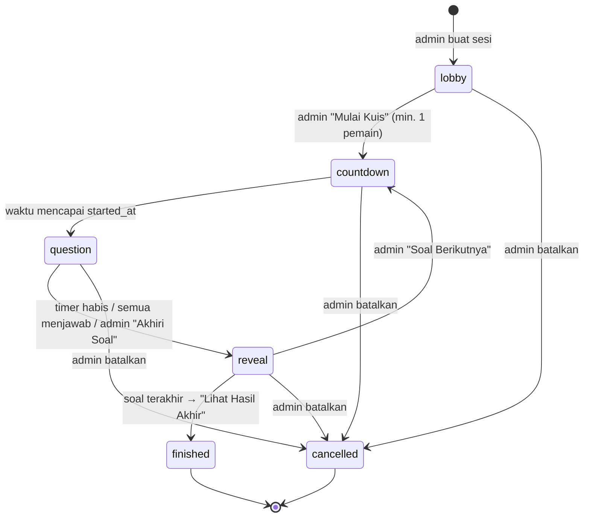
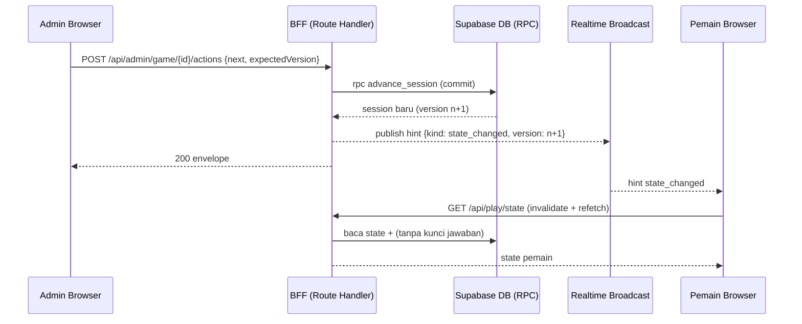
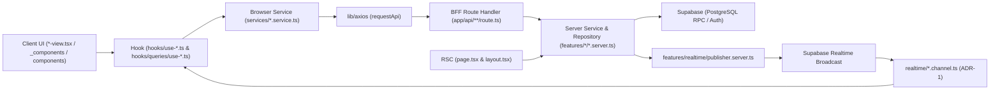

# PRD — Kuis Keberagaman & Antiintoleransi

> **Subjudul 1:** SMP Kristen Petra 3 Surabaya
> **Subjudul 2:** Petra Christian University
> **Tipe produk:** Aplikasi kuis realtime ala Quizizz/Kahoot versi sederhana, dipakai 1 kelas.
> **Stack:** Next.js (App Router) · TanStack Query · Supabase (PostgreSQL + Realtime + Auth) · Zod · Zustand · Tailwind v4
> **Panduan arsitektur wajib:** *Panduan Lengkap Arsitektur & Cara Coding Project Next.js* (selanjutnya disebut **"Guide"**). Seluruh struktur folder, boundary layer, pola service/hook/component, pola Supabase, dan quality gate mengikuti Guide. Penyimpangan hanya dua dan didokumentasikan di [§9 ADR](#9-penyimpangan-terkontrol-dari-guide-adr).
> **Versi dokumen:** 1.0 · 19 November 2026

---

## Daftar Isi

1. [Ringkasan Produk](#1-ringkasan-produk)
2. [Tujuan, Non-Tujuan & Metrik Sukses](#2-tujuan-non-tujuan--metrik-sukses)
3. [Pengguna & User Stories](#3-pengguna--user-stories)
4. [Scope Fitur & Prioritas](#4-scope-fitur--prioritas)
5. [Aturan Game & Skoring](#5-aturan-game--skoring)
6. [State Machine Sesi](#6-state-machine-sesi)
7. [Desain Realtime](#7-desain-realtime)
8. [Arsitektur & Mapping ke Guide](#8-arsitektur--mapping-ke-guide)
9. [Penyimpangan Terkontrol dari Guide (ADR)](#9-penyimpangan-terkontrol-dari-guide-adr)
10. [Model Data (PostgreSQL)](#10-model-data-postgresql)
11. [Keamanan & RLS](#11-keamanan--rls)
12. [Kontrak API (BFF)](#12-kontrak-api-bff)
13. [Struktur Folder Proyek](#13-struktur-folder-proyek)
14. [Konstanta, Query Keys, Service & Hook](#14-konstanta-query-keys-service--hook)
15. [Desain UI/UX](#15-desain-uiux)
16. [Seeder Soal Awal](#16-seeder-soal-awal)
17. [Penanganan Error & Skenario Gagal](#17-penanganan-error--skenario-gagal)
18. [Non-Functional Requirements](#18-non-functional-requirements)
19. [Strategi Testing & Quality Gate](#19-strategi-testing--quality-gate)
20. [Environment, Deploy & Operasional](#20-environment-deploy--operasional)
21. [Roadmap Implementasi (Checklist Guide §16)](#21-roadmap-implementasi-checklist-guide-16)
22. [Acceptance Criteria](#22-acceptance-criteria)
23. [Risiko, Asumsi & Pertanyaan Terbuka](#23-risiko-asumsi--pertanyaan-terbuka)

---

## 1. Ringkasan Produk

**Kuis Keberagaman & Antiintoleransi** adalah game kuis kelas. Admin (dosen/asisten) membuka sebuah sesi, mahasiswa bergabung dari HP hanya dengan memasukkan nama, lalu admin menjalankan soal satu per satu. Pemain menjawab sambil berlomba: **jawaban benar dan paling cepat mendapat skor terbesar**. Admin melihat leaderboard realtime dan mengontrol alur; di akhir ditampilkan peringkat final.

Konten awal (seeder) adalah 5 soal tentang keberagaman dan antiintoleransi (lihat [§16](#16-seeder-soal-awal)).

**Prinsip produk:**

| Prinsip | Konsekuensi |
| --- | --- |
| Simple & clean | Satu tema visual, tanpa fitur yang tidak dibutuhkan 1 kelas. |
| Server-authoritative | Waktu, skor, dan fase soal ditentukan server (jam database), bukan browser. |
| Realtime tapi tahan gagal | Realtime hanya "pemberi sinyal"; sumber kebenaran selalu database lewat BFF. Jika realtime putus, polling otomatis mengambil alih. |
| Jawaban benar tidak pernah bocor | Kunci jawaban tidak dikirim ke browser pemain sebelum fase *reveal*. |
| Ikuti Guide | Boundary layer, naming, dan pola coding identik dengan Guide. |

---

## 2. Tujuan, Non-Tujuan & Metrik Sukses

### 2.1 Tujuan

1. Satu kelas (target **≤ 60 pemain bersamaan**, dirancang aman hingga ±150) dapat bermain satu sesi penuh tanpa gangguan.
2. Pemain join hanya dengan nama; tampilan awal hanya judul + input nama.
3. Admin dapat membuat sesi, memulai, mengontrol soal, melihat leaderboard live, dan melihat hasil akhir.
4. Admin dapat CRUD soal (tambah, ubah, arsip, urutkan).
5. Skor adil: kombinasi ketepatan + kecepatan, dihitung server.
6. Semua pembaruan (pemain masuk, soal baru, jawaban masuk, leaderboard) terasa realtime (< 1 detik pada kondisi normal).

### 2.2 Non-Tujuan (v1)

- Akun pemain / login pemain / riwayat per-pemain lintas sesi.
- Banyak ruangan paralel dengan kode join (v1: **satu sesi aktif sekaligus**).
- Musik, meme, power-up, tim, mode homework, upload gambar soal.
- Multi-admin dengan role berbeda (v1: semua admin setara).
- Aplikasi native.

### 2.3 Metrik Sukses

| Metrik | Target |
| --- | --- |
| Waktu pemain dari buka web sampai masuk ruang tunggu | < 15 detik |
| Latensi sinyal state (admin klik → layar pemain berubah) | p95 < 1,5 detik |
| Jawaban terkirim sukses | ≥ 99% (idempoten, retry aman) |
| Pemain yang refresh/putus dan kembali ke sesi yang sama | 100% (cookie identitas) |
| Quality gate Guide §15.3 (`npm run check`) | Hijau |

---

## 3. Pengguna & User Stories

### 3.1 Persona

- **Pemain (Mahasiswa)** — membuka link di HP, tanpa akun, ingin cepat masuk dan bermain.
- **Admin (Dosen/Asisten)** — login email+password, biasanya memproyeksikan layar admin ke kelas.

### 3.2 User Stories — Pemain

| ID | Story | Prioritas |
| --- | --- | --- |
| P-01 | Sebagai pemain, saya melihat judul + subjudul dan kolom nama sehingga bisa langsung join. | P0 |
| P-02 | Saya mengisi nama lalu masuk **ruang tunggu** dan melihat siapa saja yang sudah bergabung. | P0 |
| P-03 | Saya otomatis pindah ke soal pertama ketika admin memulai (tanpa refresh). | P0 |
| P-04 | Saya melihat timer hitung mundur dan opsi jawaban; saya bisa menjawab sekali. | P0 |
| P-05 | Setelah soal berakhir saya melihat jawaban benar, poin yang saya dapat, dan peringkat saya. | P0 |
| P-06 | Di akhir saya melihat papan peringkat final dan posisi saya. | P0 |
| P-07 | Jika halaman ter-refresh atau koneksi putus, saya kembali sebagai pemain yang sama. | P0 |
| P-08 | Jika belum ada sesi dibuka, saya melihat pesan menunggu dan otomatis masuk saat sesi dibuka. | P0 |
| P-09 | Jika nama saya sudah dipakai, saya diberi pesan jelas dan boleh mengganti. | P0 |

### 3.3 User Stories — Admin

| ID | Story | Prioritas |
| --- | --- | --- |
| A-01 | Saya login di `/admin/login` dengan email & password. | P0 |
| A-02 | Saya membuat sesi baru; sesi berstatus *lobby* dan pemain bisa join. | P0 |
| A-03 | Saya melihat daftar pemain masuk secara live dan menekan **Mulai Kuis**. | P0 |
| A-04 | Saya melihat soal aktif, timer, jumlah yang sudah menjawab (`12/30`), dan **leaderboard realtime**. | P0 |
| A-05 | Saya dapat mengakhiri soal lebih cepat, lalu menekan **Soal Berikutnya**. | P0 |
| A-06 | Di akhir, saya melihat hasil final berurutan dari skor tertinggi. | P0 |
| A-07 | Saya dapat CRUD soal (tambah, edit, arsipkan, ubah urutan). | P0 |
| A-08 | Saya dapat mengeluarkan (kick) pemain bernama tidak pantas. | P1 |
| A-09 | Saya dapat melihat riwayat sesi dan mengekspor hasil ke CSV. | P1 |
| A-10 | Saya dapat menyembunyikan skor sementara di layar admin saat diproyeksikan. | P1 |
| A-11 | Saya dapat membatalkan sesi yang sedang berjalan. | P0 |

---

## 4. Scope Fitur & Prioritas

Fitur tambahan yang ditambahkan agar "mirip Quizizz" tetapi tetap ringan:

| Fitur | Prioritas | Catatan |
| --- | --- | --- |
| **Timer per soal** + bar hitung mundur | P0 | Batas waktu per soal (default 20 dtk). |
| **Countdown pembuka 3 detik** sebelum soal aktif | P0 | Adil: semua klien sempat memuat soal sebelum waktu berjalan. |
| **Fase reveal** (jawaban benar + distribusi jawaban) | P0 | Distribusi per opsi sebagai bar sederhana. |
| **Auto-lanjut ke reveal** bila semua pemain sudah menjawab | P0 | Tanpa menunggu timer habis. |
| **Peringkat & poin** per soal untuk pemain | P0 | |
| **Podium top 3** di hasil akhir | P0 | Layout sederhana. |
| Soal Benar/Salah **dan** Pilihan Ganda (2–4 opsi) | P0 | Sesuai data soal dari pengguna. |
| Penjelasan jawaban (opsional) | P1 | Ditampilkan saat reveal bila diisi. |
| Kick pemain | P1 | |
| Ekspor CSV hasil sesi | P1 | |
| PIN join 4 digit opsional | P1 | Mencegah orang luar yang tahu URL ikut masuk. |
| Toggle "sembunyikan skor live" di admin | P1 | Preferensi tersimpan (Zustand persist). |
| Kunci pendaftaran setelah mulai (`allow_late_join`) | P0 | Default: terkunci. Admin dapat membuka. |
| Riwayat sesi | P1 | |
| Efek suara / musik / confetti | P2 | Di luar v1. |

---

## 5. Aturan Game & Skoring

### 5.1 Aturan umum

- Hanya **satu sesi aktif** (`lobby` atau `running`) pada satu waktu.
- Pemain join hanya saat sesi `lobby` (atau saat `running` bila `allow_late_join = true`; pemain terlambat mendapat 0 untuk soal yang terlewat).
- Nama pemain: 2–24 karakter, spasi dinormalisasi, huruf/angka/spasi/`.-_'`; **unik per sesi** (tidak peka huruf besar/kecil).
- Setiap pemain menjawab **maksimal sekali** per soal. Percobaan kedua bersifat idempoten (tidak mengubah jawaban pertama).
- Jawaban tidak menampilkan benar/salah langsung kepada pemain; hasil dibuka serentak pada fase *reveal* (mencegah contekan layar teman).
- Soal tidak dapat diubah/ditambah/diarsipkan saat ada sesi aktif (bank soal terkunci).
- Urutan soal dibekukan (snapshot `question_order`) saat sesi dibuat.

### 5.2 Rumus skor

Hanya jawaban **benar** yang mendapat poin. Poin menurun linear dari `base_points` (menjawab seketika) hingga **50%** `base_points` (menjawab di detik terakhir):

```text
response_ms = min(waktu_server_saat_jawaban − question_started_at, time_limit_ms)
points      = round( base_points × (1 − 0.5 × response_ms / time_limit_ms) )   -- jika benar
points      = 0                                                                  -- jika salah / tidak menjawab
```

Contoh (`base_points = 1000`, `time_limit = 20 dtk`):

| Waktu jawab | Benar | Poin |
| --- | --- | --- |
| 0 dtk | ✅ | 1000 |
| 3 dtk | ✅ | 925 |
| 10 dtk | ✅ | 750 |
| 20 dtk | ✅ | 500 |
| kapan pun | ❌ | 0 |

### 5.3 Peringkat & tie-break

Urutan leaderboard (konsisten di seluruh layar):

1. `total_score` menurun
2. `total_correct_ms` menaik (total waktu menjawab pada soal yang benar — lebih cepat lebih baik)
3. `joined_at` menaik (deterministik)

### 5.4 Sumber waktu & keadilan

- **Satu-satunya jam yang dipercaya adalah jam PostgreSQL** (`clock_timestamp()`). Node.js dan browser tidak dipakai untuk menghitung skor.
- `question_started_at` = waktu admin menekan Next **+ `QUESTION_LEAD_IN_MS` (3000 ms)**. Jawaban sebelum `started_at` ditolak (`ANSWER_TOO_EARLY`). Ini memberi waktu semua perangkat memuat soal sehingga pemain dengan koneksi lambat tidak dirugikan pada awal soal.
- Toleransi akhir: jawaban diterima hingga `ends_at + ANSWER_GRACE_MS (500 ms)` untuk menutup selisih jaringan; poin tetap dihitung dengan `response_ms` yang dibatasi `time_limit`.
- Latensi jaringan tiap pemain masuk ke `response_ms` (sama seperti Kahoot/Quizizz). Untuk skala kelas hal ini diterima; mitigasi: region Supabase & Vercel di Singapura (§20).
- Timer di browser hanyalah **tampilan**: klien menghitung `offset = serverNow − clientNow` dari setiap respons state (dikoreksi setengah RTT) lalu menampilkan sisa waktu `endsAt − (now + offset)`.

---

## 6. State Machine Sesi

### 6.1 Status tersimpan vs fase turunan

Status yang **disimpan** di `game_sessions.status`: `lobby`, `running`, `finished`, `cancelled`.
Fase yang **diturunkan** (`resolvePhase`, fungsi pure di `src/utils/game-phase.ts`) dari status + timestamp + `now` milik DB:

| Fase | Kondisi |
| --- | --- |
| `lobby` | `status = lobby` |
| `countdown` | `running` dan `now < question_started_at` |
| `question` | `running`, `started_at ≤ now ≤ ends_at`, `question_closed_at IS NULL` |
| `reveal` | `running` dan (`now > ends_at` **atau** `question_closed_at IS NOT NULL`) |
| `finished` | `status = finished` |
| `cancelled` | `status = cancelled` |

**Lazy phase resolution:** tidak ada cron/worker untuk memindahkan `question → reveal`. Fase dihitung saat dibaca, dan `submit_answer` menutup soal lebih awal bila semua pemain sudah menjawab. Ini menghilangkan kebutuhan proses latar di serverless dan mencegah *drift*.

### 6.2 Diagram



### 6.3 Aksi admin (concurrency-safe)

Semua aksi mengirim `expectedVersion` (= `state_version`). Server menjalankan `UPDATE ... WHERE state_version = :expected` di dalam RPC dengan `FOR UPDATE`; jika tidak cocok → `409 CONFLICT`. Klik ganda "Next" aman: klik kedua mendapat 409 dan UI menyegarkan state.

| Aksi | Syarat | Efek |
| --- | --- | --- |
| `start` | status `lobby`, ≥ 1 pemain | `running`, `current_index = 0`, set jadwal soal |
| `close_question` | fase `countdown`/`question` | `question_closed_at = now` |
| `next` | fase `reveal`, masih ada soal berikutnya | `current_index + 1`, set jadwal soal baru |
| `finish` | fase `reveal` pada soal terakhir | `finished` |
| `cancel` | status `lobby`/`running` | `cancelled` |

---

## 7. Desain Realtime

### 7.1 Pola: "Sinyal Tipis + Refetch" (Signal-and-Refetch)

Realtime **tidak membawa data game**. Server (BFF) memancarkan *hint* ringan lewat **Supabase Realtime Broadcast** setelah commit database. Klien yang menerima hint meng-*invalidate* query TanStack terkait, lalu mengambil data resmi lewat BFF.



**Mengapa pola ini:**
- Kunci jawaban & data sensitif tidak pernah lewat kanal realtime publik.
- Hint yang dipalsukan pihak lain hanya memicu refetch tambahan (tidak ada efek terhadap data).
- Satu jalur data (BFF) → validasi Zod, logging, dan test tetap satu tempat.
- Hint hilang/terlambat tidak merusak kebenaran data (ada fallback polling, lihat 7.4).

### 7.2 Kanal & event

Kanal dipisah per **audiens** untuk menghindari ledakan pesan N² (jawaban 60 pemain × 60 pelanggan = 3.600 pesan dalam hitungan detik, melewati batas pesan/detik paket gratis).

| Kanal | Pelanggan | Event (`payload`) | Frekuensi |
| --- | --- | --- | --- |
| `kuis:lobby` | Pengunjung beranda tanpa sesi | `session_opened`, `session_closed` | Sangat jarang |
| `kuis:s:{sessionId}:players` | Semua pemain sesi | `state_changed {version}` | ±3 per soal |
| `kuis:s:{sessionId}:admin` | Admin saja (1 pelanggan) | `state_changed`, `players_changed`, `answers_changed` `{version}` | Per join/jawaban — hanya 1 penerima |

- Payload divalidasi `realtimeHintSchema` (`z.strictObject({ kind, version })`); pesan tak valid diabaikan.
- `version` monoton; klien mengabaikan hint dengan `version ≤` versi terakhir yang sudah diproses (untuk `state_changed`).
- **Throttle admin:** hint `answers_changed`/`players_changed` diproses dengan *leading + trailing throttle 400 ms* agar 60 jawaban beruntun hanya memicu ±3 refetch.
- **Jitter pemain:** refetch setelah `state_changed` ditunda acak 0–250 ms agar 60 klien tidak menyerang BFF di milidetik yang sama.
- **Presence tidak dipakai** (rawan spoof, tidak diperlukan; daftar pemain berasal dari DB).
- Lobi pemain: daftar nama disegarkan **polling 5 detik** (bukan hint per join) agar kanal pemain tetap sepi; admin mendapat `players_changed` instan.

### 7.3 Publisher (server)

`src/features/realtime/publisher.server.ts` (`'server-only'`): `publishHint(channel, hint)`.

- Dipanggil **setelah** commit DB berhasil; **best-effort** — kegagalan hanya di-log dan **tidak pernah** menggagalkan request utama.
- Timeout 1,5 detik (`AbortSignal.timeout`).
- Memakai Realtime REST broadcast (`channel.httpSend` pada `@supabase/supabase-js`) dengan kunci publishable; tidak butuh service role.

### 7.4 Fallback & ketahanan klien

- Status koneksi dipantau di `useSessionRealtime` (`SUBSCRIBED | CONNECTING | DISCONNECTED`).
- **Saat tidak `SUBSCRIBED`:** query state memakai `refetchInterval: 3000`. Saat kembali `SUBSCRIBED`: satu `refetch` penuh, polling dimatikan.
- Selalu refetch pada `visibilitychange` (tab kembali aktif), `online`, dan `window focus` (default TanStack).
- **Timer-driven refetch:** saat `endsAt` terlewati (hitungan waktu server), klien refetch (+jitter). Jika server masih mengembalikan `question` karena selisih jam kecil, ulangi setelah 300 ms (maks 5 kali, backoff).
- Indikator kecil "Terhubung / Menyambung ulang…" (`ConnectionBadge`) di layar.

### 7.5 Admin: sumber data live

Admin menerima hint di kanal `:admin` → invalidate `ADMIN_GAME`. Endpoint admin state mengembalikan: sesi, pemain, `answeredCount`, leaderboard (top 10 live), distribusi (hanya bila fase `reveal`), kunci jawaban soal aktif.

---

## 8. Arsitektur & Mapping ke Guide

Alur data identik dengan Guide §2:



### 8.1 Peta tanggung jawab layer

| Layer (Guide) | Isi di proyek ini |
| --- | --- |
| RSC `page.tsx` | Tipis: `connection()` + `<Suspense>` + baca state awal via `features/*/service.server.ts`, render `*-view.tsx`. |
| `*-view.tsx` | Hanya hubungkan controller hook dengan subkomponen. |
| `hooks/queries/` | `use-play.ts`, `use-admin-game.ts`, `use-admin-questions.ts`, `use-admin-auth.ts`. |
| `hooks/use-*.ts` | `use-join-flow`, `use-play-controller`, `use-admin-game-console`, `use-admin-questions-manager`, `use-countdown`, `use-session-realtime`. |
| `services/` | `play.service.ts`, `admin-game.service.ts`, `admin-question.service.ts`, `auth.service.ts` (semua via `requestApi`). |
| `features/` | `auth/`, `question/`, `game/`, `play/`, `realtime/` (semua `server-only`). |
| `lib/supabase/` | `client.ts` (auth admin), `server.ts`, `proxy.ts`, `public-read.server.ts` (tidak dipakai — tak ada data publik), **`service-role.server.ts` (ADR-2)**, **`realtime-client.ts` (ADR-1)**. |
| Zustand | `preferences.store.ts` saja (nama terakhir pemain, sembunyikan skor live). |

### 8.2 Halaman (routes)

| Route | Akses | Deskripsi |
| --- | --- | --- |
| `/` | Publik | Join: judul, subjudul, input nama. Redirect ke `/play` bila sudah punya identitas pemain aktif. |
| `/play` | Pemain (cookie) | Satu halaman untuk semua fase: ruang tunggu → countdown → soal → reveal → hasil akhir. |
| `/admin/login` | Publik | Login admin. |
| `/admin` | Admin | **Ruang Kontrol**: buat sesi, lobby live, kontrol soal, leaderboard live, hasil akhir. |
| `/admin/questions` | Admin | CRUD soal (dialog editor). |
| `/admin/history` | Admin (P1) | Riwayat sesi + hasil + ekspor CSV. |

---

## 9. Penyimpangan Terkontrol dari Guide (ADR)

Guide melarang `hooks/*` dan `components/*` menyentuh `@supabase/*`, serta tidak punya konteks Supabase untuk penulisan oleh pengguna anonim. Dua penyesuaian berikut **wajib** dimasukkan ke `tooling/eslint/architecture.mjs` dan diuji di `scripts/test-eslint-boundaries.mjs` agar boundary tetap otomatis ditegakkan.

### ADR-1 — Layer Realtime Adapter (`src/realtime/*.channel.ts`)

- **Konteks:** langganan Realtime hanya bisa dilakukan dari browser; Guide tidak menyediakan layer untuk itu.
- **Keputusan:** tambah layer baru setara "Browser Service" untuk event, bukan HTTP.
  - `src/lib/supabase/realtime-client.ts` — `'use client'`, `createClient` anon tanpa session (`persistSession: false`, `autoRefreshToken: false`).
  - `src/realtime/<nama>.channel.ts` — membungkus `supabase.channel(...)`, memvalidasi payload dengan Zod, mengekspor fungsi `subscribe<Name>Channel(options): () => void` (unsubscribe).
  - `src/hooks/use-session-realtime.ts` — satu-satunya konsumen; menerjemahkan hint menjadi `queryClient.invalidateQueries`.
- **Aturan boundary baru:**

| Layer | Boleh impor | Dilarang impor |
| --- | --- | --- |
| `src/realtime/**` | `@/lib/supabase/realtime-client`, `@/validations/*`, `@/types/*`, `@/constants/*`, `@/utils/*` | `axios`, `lib/axios`, `@tanstack/react-query`, `hooks/*`, `components/*`, `features/*`, `services/*`, `fetch()` |
| `src/hooks/use-*.ts` | (tambahan) `@/realtime/*` | tetap: `@supabase/*`, `lib/supabase/*` langsung |
| `components/**`, `_components/**` | — | `@/realtime/*` (hanya hook yang boleh) |

### ADR-2 — Konteks Supabase ke-5: Service Role (`src/lib/supabase/service-role.server.ts`)

- **Konteks:** pemain anonim menulis data (join, jawaban) tanpa Supabase Auth; RLS tidak bisa mengidentifikasi mereka.
- **Keputusan:** semua tabel game **RLS-on tanpa policy anon**; penulisan pemain lewat **RPC `SECURITY DEFINER`** yang hanya `GRANT EXECUTE` ke `service_role`, dipanggil dari BFF dengan kunci secret server.
- **Aturan boundary baru:** `service-role.server.ts` hanya boleh diimpor oleh `src/features/**/repository.server.ts`. Wajib `import 'server-only'`, tidak boleh lewat barrel, kunci hanya dibaca di `environment.server.ts`.
- Operasi admin murni data (CRUD soal) **tetap** memakai `createServerAuthClient(carrier)` + RLS (`is_admin()`), sesuai Guide.

---

## 10. Model Data (PostgreSQL)

Migrasi di `supabase/migrations/`, seed di `supabase/seed.sql`, tipe digenerate ke `src/types/database.ts` (Supabase CLI).

### 10.1 Skema

```sql
create extension if not exists pgcrypto;

create type public.question_type  as enum ('multiple_choice', 'true_false');
create type public.session_status as enum ('lobby', 'running', 'finished', 'cancelled');

-- Admin
create table public.admin_users (
  user_id    uuid primary key references auth.users (id) on delete cascade,
  created_at timestamptz not null default now()
);

create function public.is_admin() returns boolean
language sql stable security definer set search_path = '' as $$
  select exists (select 1 from public.admin_users where user_id = (select auth.uid()))
$$;

-- Bank soal
create table public.questions (
  id                 uuid primary key default gen_random_uuid(),
  type               public.question_type not null,
  prompt             text not null check (char_length(prompt) between 5 and 500),
  options            jsonb not null check (
                       jsonb_typeof(options) = 'array'
                       and jsonb_array_length(options) between 2 and 4),   -- [{id:'a', text:'...'}]
  correct_option_id  text not null,
  explanation        text check (char_length(explanation) <= 500),
  time_limit_seconds int  not null default 20  check (time_limit_seconds between 5 and 120),
  base_points        int  not null default 1000 check (base_points between 100 and 2000),
  position           int  not null,
  archived_at        timestamptz,
  created_at         timestamptz not null default now(),
  updated_at         timestamptz not null default now()
);
create index questions_active_position_idx on public.questions (position) where archived_at is null;

-- Sesi
create table public.game_sessions (
  id                   uuid primary key default gen_random_uuid(),
  status               public.session_status not null default 'lobby',
  question_order       uuid[] not null,                -- snapshot urutan soal
  total_questions      int    not null check (total_questions > 0),
  current_index        int    not null default -1,
  question_started_at  timestamptz,
  question_ends_at     timestamptz,
  question_closed_at   timestamptz,
  allow_late_join      boolean not null default false,
  join_pin             text check (join_pin ~ '^[0-9]{4}$'),   -- P1, opsional
  state_version        int    not null default 0,
  created_by           uuid   references auth.users (id),
  created_at           timestamptz not null default now(),
  started_at           timestamptz,
  finished_at          timestamptz
);
-- Hanya satu sesi aktif
create unique index one_active_session on public.game_sessions ((true))
  where status in ('lobby', 'running');

-- Pemain
create table public.players (
  id               uuid primary key default gen_random_uuid(),
  session_id       uuid not null references public.game_sessions (id) on delete cascade,
  name             text not null check (char_length(name) between 2 and 24),
  name_key         text generated always as (lower(btrim(name))) stored,
  token_hash       text not null,                      -- HMAC-SHA256(token, pepper)
  total_score      int  not null default 0,
  correct_count    int  not null default 0,
  total_correct_ms bigint not null default 0,
  joined_at        timestamptz not null default now(),
  unique (session_id, name_key)
);
create index players_leaderboard_idx
  on public.players (session_id, total_score desc, total_correct_ms asc, joined_at asc);

-- Jawaban
create table public.answers (
  id                 uuid primary key default gen_random_uuid(),
  session_id         uuid not null references public.game_sessions (id) on delete cascade,
  player_id          uuid not null references public.players (id) on delete cascade,
  question_id        uuid not null references public.questions (id),
  question_index     int  not null,
  selected_option_id text not null,
  is_correct         boolean not null,
  response_ms        int  not null check (response_ms >= 0),
  points             int  not null check (points >= 0),
  answered_at        timestamptz not null default clock_timestamp(),
  unique (session_id, player_id, question_index)       -- idempotensi jawaban
);
create index answers_session_question_idx on public.answers (session_id, question_index);
```

Trigger `set_updated_at` pada `questions`. Pemain yang di-kick dihapus (`on delete cascade` menghapus jawabannya).

### 10.2 RPC (semua `SECURITY DEFINER`, `search_path = ''`, `GRANT EXECUTE` hanya ke `service_role`)

| RPC | Tugas |
| --- | --- |
| `create_session(p_created_by, p_allow_late_join, p_join_pin)` | Auto-batalkan sesi aktif berumur > 12 jam; snapshot `question_order` dari soal aktif (urut `position`); tolak bila 0 soal. Return sesi. |
| `join_session(p_name, p_token_hash, p_pin)` | Kunci baris sesi aktif; validasi status/`allow_late_join`/PIN/kapasitas (`MAX_PLAYERS = 150`); insert pemain; error `NAME_TAKEN` bila `name_key` bentrok. |
| `advance_session(p_session_id, p_expected_version, p_action, p_lead_in_ms)` | Aksi `start` / `next` / `close_question` / `finish` / `cancel` dengan `FOR UPDATE` + cek versi; set jadwal soal memakai `clock_timestamp()`; `state_version + 1`. |
| `submit_answer(p_session_id, p_player_id, p_question_index, p_option_id)` | Inti skoring (lihat 10.3). |
| `get_leaderboard(p_session_id, p_limit)` | Urutan §5.3 beserta `rank` (`row_number()`). |
| `kick_player(p_session_id, p_player_id)` | P1. Hapus pemain, bump versi. |

### 10.3 `submit_answer` (spesifikasi referensi)

```sql
create function public.submit_answer(
  p_session_id uuid, p_player_id uuid, p_question_index int, p_option_id text
) returns table (already_answered boolean, answered_count int, total_players int, closed_early boolean)
language plpgsql security definer set search_path = '' as $$
declare
  s public.game_sessions%rowtype;
  q public.questions%rowtype;
  v_now timestamptz := clock_timestamp();
  v_ms int; v_ok boolean; v_pts int; v_ins int; v_answered int; v_total int; v_closed boolean := false;
begin
  select * into s from public.game_sessions where id = p_session_id for update;
  if not found or s.status <> 'running' then raise exception 'ANSWER_CLOSED'; end if;
  if not exists (select 1 from public.players where id = p_player_id and session_id = p_session_id)
    then raise exception 'NOT_JOINED'; end if;
  if s.current_index <> p_question_index then raise exception 'STALE_QUESTION'; end if;
  if s.question_closed_at is not null
     or v_now > s.question_ends_at + interval '500 milliseconds' then raise exception 'ANSWER_CLOSED'; end if;
  if v_now < s.question_started_at then raise exception 'ANSWER_TOO_EARLY'; end if;

  select * into q from public.questions where id = s.question_order[s.current_index + 1];
  if not exists (select 1 from jsonb_array_elements(q.options) o where o ->> 'id' = p_option_id)
    then raise exception 'INVALID_OPTION'; end if;

  v_ms  := least(floor(extract(epoch from (v_now - s.question_started_at)) * 1000),
                 q.time_limit_seconds * 1000)::int;
  v_ok  := (p_option_id = q.correct_option_id);
  v_pts := case when v_ok
             then round(q.base_points * (1 - 0.5 * least(1.0, v_ms::numeric / (q.time_limit_seconds * 1000))))::int
             else 0 end;

  insert into public.answers (session_id, player_id, question_id, question_index,
                              selected_option_id, is_correct, response_ms, points)
  values (p_session_id, p_player_id, q.id, p_question_index, p_option_id, v_ok, v_ms, v_pts)
  on conflict (session_id, player_id, question_index) do nothing;
  get diagnostics v_ins = row_count;

  if v_ins = 1 then
    update public.players
       set total_score = total_score + v_pts,
           correct_count = correct_count + (v_ok)::int,
           total_correct_ms = total_correct_ms + case when v_ok then v_ms else 0 end
     where id = p_player_id;
  end if;

  select count(*) into v_answered from public.answers
   where session_id = p_session_id and question_index = p_question_index;
  select count(*) into v_total from public.players where session_id = p_session_id;

  if v_answered >= v_total then
    update public.game_sessions
       set question_closed_at = v_now, state_version = state_version + 1 where id = p_session_id;
    v_closed := true;
  end if;
  return query select (v_ins = 0), v_answered, v_total, v_closed;
end $$;
```

`FOR UPDATE` pada baris sesi menyerialisasi jawaban per sesi (puluhan ms total untuk 60 pemain) sekaligus menjamin pengecekan "semua sudah menjawab" konsisten.

---

## 11. Keamanan & RLS

### 11.1 RLS

| Tabel | Anon | Authenticated non-admin | Admin (`is_admin()`) |
| --- | --- | --- | --- |
| `questions` | ❌ | ❌ | SELECT / INSERT / UPDATE (tanpa DELETE — arsip via `archived_at`) |
| `game_sessions`, `players`, `answers` | ❌ | ❌ | SELECT (untuk laporan) |
| `admin_users` | ❌ | ❌ | SELECT milik sendiri |

Semua penulisan game lewat RPC `service_role` (ADR-2).

### 11.2 Identitas pemain

- Saat join, server membuat `token = randomBytes(32)`, menyimpan `HMAC-SHA256(token, PLAYER_TOKEN_PEPPER)` di `players.token_hash`.
- Cookie `kuis_player = <playerId>.<token>` — `HttpOnly`, `Secure`, `SameSite=Lax`, `Path=/`, `Max-Age=12h`.
- Setiap endpoint pemain memverifikasi cookie dengan `timingSafeEqual`. Cookie hilang → pemain harus join ulang (dengan nama berbeda bila nama lama masih terpakai; admin dapat kick nama lama).
- Dua tab pemain yang sama aman (jawaban idempoten).

### 11.3 Kontrol lain

| Ancaman | Mitigasi |
| --- | --- |
| Kunci jawaban bocor | Payload pemain tidak menyertakan `correct_option_id` sampai fase `reveal`; Zod `z.strictObject` per fase mencegah field ekstra. |
| Manipulasi waktu/skor | Skor dihitung di DB dengan `clock_timestamp()`; klien tidak mengirim waktu/poin. |
| Jawab ganda / replay | Unique `(session_id, player_id, question_index)` + `STALE_QUESTION`. |
| CSRF | `assertSameOriginRequest` pada semua `POST/PATCH/DELETE` (admin **dan** pemain). |
| Spam join/jawab | Batas `MAX_PLAYERS`, batas body (`readBoundedJsonBody` ≤ 1 KB endpoint pemain), unique nama; rate-limit per IP via Vercel Firewall (P1). |
| Orang luar ikut sesi | PIN 4 digit opsional (P1) ditampilkan admin di proyektor. |
| XSS nama pemain | React meng-escape; nama divalidasi regex allowlist; tidak ada `dangerouslySetInnerHTML`. |
| Kebocoran secret | `SUPABASE_SECRET_KEY` & `PLAYER_TOKEN_PEPPER` hanya di `environment.server.ts`; `parseEnvironment` tidak mencetak nilai. |
| Spoof hint realtime | Hint hanya memicu refetch; payload divalidasi; tidak ada data di dalamnya. |
| Cache admin bocor antar sesi | `removeQueries(ADMIN_ROOT)` saat login/logout (Guide §8.4). |

---

## 12. Kontrak API (BFF)

Semua respons memakai envelope Guide §6.3 (`ok`, `data`, `requestId`, `meta?`) dengan `Cache-Control: no-store`. Semua input divalidasi Zod `strictObject`.

### 12.1 Endpoint Pemain

| Method & Path | Body / Query | Respons `data` | Error utama |
| --- | --- | --- | --- |
| `GET /api/play/me` | — (cookie) | `{ player: {id,name}\|null, session: {id,status}\|null }` | — |
| `POST /api/play/join` | `{ name, pin? }` | `{ player, session }` + set cookie | `NO_ACTIVE_SESSION` 404, `SESSION_LOCKED` 409, `NAME_TAKEN` 409, `NAME_INVALID` 422, `SESSION_FULL` 409, `INVALID_PIN` 403 |
| `GET /api/play/state` | — (cookie) | `PlayerState` (union di bawah) | `NOT_JOINED` 401, `NO_ACTIVE_SESSION` 404 |
| `POST /api/play/answer` | `{ questionIndex, optionId }` | `{ accepted: true, alreadyAnswered }` | `ANSWER_CLOSED` 409, `ANSWER_TOO_EARLY` 409, `STALE_QUESTION` 409, `INVALID_OPTION` 422, `NOT_JOINED` 401 |

**`PlayerState`** (discriminated union `phase`; semua memuat `serverNow`, `version`, `session: {id, totalQuestions}`, `me: {id, name, totalScore, rank}`):

```ts
type PlayerState =
  | { phase: 'lobby'; players: { id: string; name: string }[]; playerCount: number }
  | { phase: 'countdown' | 'question';
      questionIndex: number;
      question: { prompt: string; type: QuestionType; options: { id: string; text: string }[];
                  timeLimitSeconds: number };
      startsAt: string; endsAt: string;          // ISO, jam server
      myAnswer: { optionId: string } | null }
  | { phase: 'reveal';
      questionIndex: number;
      question: { prompt: string; options: { id: string; text: string }[]; explanation: string | null };
      correctOptionId: string;
      myResult: { optionId: string | null; isCorrect: boolean; points: number; responseMs: number | null };
      distribution: Record<string, number>;
      leaderboard: LeaderboardEntry[];           // top 5
      isLastQuestion: boolean }
  | { phase: 'finished'; leaderboard: LeaderboardEntry[] }   // seluruh pemain
  | { phase: 'cancelled' };
```

### 12.2 Endpoint Admin (urutan pertahanan Guide §13.4: carrier → CSRF → `requireApiAdmin` → body terbatas → Zod)

| Method & Path | Fungsi |
| --- | --- |
| `POST /api/auth/login`, `POST /api/auth/logout`, `GET /api/admin/session` | Auth admin (Guide §8.4) |
| `GET /api/admin/questions` | Daftar soal aktif (urut `position`) beserta `updatedAt`, flag `locked` |
| `POST /api/admin/questions` | Buat soal |
| `PATCH /api/admin/questions/[id]` | Ubah soal (`expectedUpdatedAt` → 409 bila basi) |
| `DELETE /api/admin/questions/[id]` | Arsipkan soal |
| `POST /api/admin/questions/reorder` | `{ orderedIds: string[] }` |
| `GET /api/admin/game` | State sesi aktif untuk admin (lihat 12.3) atau `null` |
| `POST /api/admin/game` | Buat sesi `{ allowLateJoin, joinPin? }` |
| `POST /api/admin/game/[id]/actions` | `{ action: 'start'\|'close_question'\|'next'\|'finish'\|'cancel', expectedVersion }` |
| `DELETE /api/admin/game/[id]/players/[playerId]` | Kick (P1) |
| `GET /api/admin/game/history` | Daftar sesi selesai (P1) |
| `GET /api/admin/game/[id]/results` | Leaderboard final + statistik per soal (P1) |
| `GET /api/admin/game/[id]/export` | CSV (P1) |
| `GET /api/health` | Healthcheck |

Mutasi soal terkunci saat ada sesi aktif → `409 QUESTION_BANK_LOCKED`.

### 12.3 `AdminGameState`

```ts
interface AdminGameState {
  serverNow: string; version: number;
  session: { id: string; status: SessionStatus; phase: Phase; currentIndex: number;
             totalQuestions: number; allowLateJoin: boolean; joinPin: string | null };
  currentQuestion: { prompt: string; options: Option[]; correctOptionId: string;
                     timeLimitSeconds: number; startsAt: string; endsAt: string } | null;
  players: { id: string; name: string; joinedAt: string }[];
  answeredCount: number;
  distribution: Record<string, number> | null;     // hanya saat reveal
  leaderboard: LeaderboardEntry[];                 // top 10 (finished: semua)
}
```

### 12.4 Kode error baru (`ERROR_COPY` / `API_ERROR_CODES`)

Tambahan atas kode Guide: `NO_ACTIVE_SESSION`, `SESSION_LOCKED`, `SESSION_FULL`, `NAME_TAKEN`, `NAME_INVALID`, `INVALID_PIN`, `NOT_JOINED`, `ANSWER_CLOSED`, `ANSWER_TOO_EARLY`, `STALE_QUESTION`, `INVALID_OPTION`, `CONFLICT`, `QUESTION_BANK_LOCKED`, `NO_QUESTIONS`, `ACTIVE_SESSION_EXISTS`. Semua pesan berbahasa Indonesia di `copy.constant.ts`.

---

## 13. Struktur Folder Proyek

Mengikuti Guide §3 (hanya modul domain yang berbeda; file wajib Guide seperti `parse-environment.ts`, `lib/axios/*`, `query-client.ts`, `toast.ts`, `logger.server.ts`, `response.server.ts`, `request-body.server.ts` dipakai apa adanya).

```text
kuis-keberagaman/
├── docs/                       # PRD.md (dokumen ini), database.md, security.md
├── public/
├── scripts/                    # test-eslint-boundaries.mjs, test-server-boundary.mjs
├── supabase/
│   ├── migrations/             # skema, RLS, RPC
│   ├── seed.sql                # 5 soal awal + (dev) admin
│   └── tests/                  # pgTAP: skoring, idempotensi, RLS, one_active_session
├── tests/ {unit, server, dom, e2e}
├── tooling/eslint/architecture.mjs      # + aturan ADR-1 & ADR-2
└── src/
    ├── app/
    │   ├── layout.tsx                    # DM Sans, metadata, ReactQueryProvider, ToastProvider
    │   ├── globals.css
    │   ├── (site)/
    │   │   ├── layout.tsx
    │   │   ├── page.tsx                  # Join (RSC tipis)
    │   │   ├── _components/              # join-view.tsx, join-form.tsx, waiting-for-session.tsx
    │   │   └── play/
    │   │       ├── page.tsx
    │   │       ├── loading.tsx
    │   │       └── _components/
    │   │           ├── play-view.tsx
    │   │           ├── play-lobby-panel.tsx
    │   │           ├── play-countdown-panel.tsx
    │   │           ├── play-question-panel.tsx
    │   │           ├── play-answer-options.tsx
    │   │           ├── play-waiting-panel.tsx      # "jawaban terkirim"
    │   │           ├── play-reveal-panel.tsx
    │   │           ├── play-finished-panel.tsx
    │   │           └── play-cancelled-panel.tsx
    │   ├── admin/
    │   │   ├── login/ (page.tsx + _components/admin-login-view.tsx)
    │   │   └── (dashboard)/
    │   │       ├── layout.tsx            # requireAdminSession
    │   │       ├── _components/          # admin-shell.tsx
    │   │       ├── page.tsx              # Ruang Kontrol
    │   │       ├── _components/console/  # admin-game-view.tsx, admin-create-session-card.tsx,
    │   │       │                         # admin-lobby-panel.tsx, admin-question-panel.tsx,
    │   │       │                         # admin-reveal-panel.tsx, admin-final-panel.tsx,
    │   │       │                         # admin-live-leaderboard.tsx, admin-control-bar.tsx
    │   │       ├── questions/ (page.tsx + _components/admin-questions-view.tsx,
    │   │       │               admin-question-card.tsx, admin-question-editor-dialog.tsx)
    │   │       └── history/ (page.tsx + _components/admin-history-view.tsx)   # P1
    │   └── api/
    │       ├── health/route.ts
    │       ├── auth/{login,logout}/route.ts
    │       ├── play/{me,join,state,answer}/route.ts
    │       └── admin/
    │           ├── session/route.ts
    │           ├── questions/{route.ts,[id]/route.ts,reorder/route.ts}
    │           └── game/{route.ts,history/route.ts,[id]/{actions,results,export}/route.ts,
    │                     [id]/players/[playerId]/route.ts}
    ├── components/
    │   ├── ui/        # button, card, input, form-field, dialog, badge, skeleton, feedback,
    │   │              # progress-bar (timer), select, textarea
    │   └── common/
    │       ├── game/      # leaderboard-list.tsx, podium.tsx, countdown-bar.tsx, answer-option.tsx,
    │       │              # player-chip.tsx, distribution-bars.tsx, connection-badge.tsx
    │       ├── layout/    # app-brand-header.tsx (judul + 2 subjudul), page-header.tsx
    │       └── feedback/  # empty-state.tsx, error-state.tsx, confirm-dialog.tsx, toast-container.tsx
    ├── config/        # environment.client.ts, environment.server.ts, index.ts, parse-environment.ts
    ├── constants/     # app, copy, endpoint, query-keys, routes, ui, validation,
    │                  # game.constant.ts (LIMITS, LEAD_IN, GRACE, COPY), realtime.constant.ts
    ├── features/
    │   ├── auth/      # admin-guard, csrf, errors, http, service (.server.ts)
    │   ├── question/  # repository.server.ts, service.server.ts, errors.server.ts
    │   ├── game/      # repository.server.ts (RPC), service.server.ts (state builder), errors.server.ts
    │   ├── play/      # identity.server.ts (cookie/HMAC), service.server.ts
    │   └── realtime/  # publisher.server.ts
    ├── hooks/
    │   ├── queries/   # query-helpers.ts, use-play.ts, use-admin-game.ts, use-admin-questions.ts, use-admin-auth.ts
    │   ├── use-join-flow.ts
    │   ├── use-play-controller.ts
    │   ├── use-countdown.ts
    │   ├── use-session-realtime.ts      # ADR-1
    │   ├── use-admin-game-console.ts
    │   ├── use-admin-questions-manager.ts
    │   └── use-admin-login-flow.ts
    ├── lib/           # axios/, supabase/{client,server,proxy,no-store-fetch,service-role.server,realtime-client}.ts,
    │                  # errors.ts, logger.server.ts, query-client.ts, request-body.server.ts, response.server.ts, toast.ts
    ├── providers/     # react-query-provider.tsx, toast-provider.tsx, preferences-provider.tsx
    ├── realtime/      # lobby.channel.ts, session-players.channel.ts, session-admin.channel.ts   # ADR-1
    ├── services/      # auth.service.ts, play.service.ts, admin-question.service.ts, admin-game.service.ts
    ├── stores/        # preferences.store.ts
    ├── styles/        # tokens.css, base.css, primitives.css, features/{play,admin}.css
    ├── types/         # api.ts, database.ts, game.ts, question.ts, auth.ts, index.ts
    ├── utils/         # api.ts, cn.ts, game-phase.ts, game-timer.ts, question-form.ts, csv.ts, index.ts
    ├── validations/   # api.schema, env.schema, auth.schema, question.schema, game.schema, realtime.schema
    └── proxy.ts       # matcher: /admin/:path*, /api/admin/:path*, /api/auth/:path*, /auth/:path*
```

> Guide: folder `_components/` hanya berisi `.tsx`; mapper, helper, tipe, dan hook diletakkan di `utils/`, `types/`, `hooks/`.

---

## 14. Konstanta, Query Keys, Service & Hook

### 14.1 `constants/game.constant.ts`

```ts
export const GAME_LIMITS = {
  NAME_MIN: 2, NAME_MAX: 24, MAX_PLAYERS: 150,
  OPTIONS_MIN: 2, OPTIONS_MAX: 4,
  PROMPT_MIN: 5, PROMPT_MAX: 500, OPTION_TEXT_MAX: 120, EXPLANATION_MAX: 500,
  TIME_LIMIT_CHOICES: [10, 15, 20, 30, 45, 60] as const,
  DEFAULT_TIME_LIMIT_S: 20, DEFAULT_BASE_POINTS: 1000,
  QUESTION_LEAD_IN_MS: 3000, ANSWER_GRACE_MS: 500,
  LEADERBOARD_LIVE_SIZE: 10, LEADERBOARD_REVEAL_SIZE: 5,
  PLAYER_COOKIE_MAX_AGE_S: 43_200,
  PLAYER_BODY_MAX_BYTES: 1024,
} as const;

export const REALTIME_LIMITS = {
  ADMIN_THROTTLE_MS: 400, PLAYER_JITTER_MAX_MS: 250,
  FALLBACK_POLL_MS: 3000, LOBBY_POLL_MS: 5000,
  TIMEUP_RETRY_MS: 300, TIMEUP_MAX_RETRIES: 5,
} as const;
```

### 14.2 `constants/query-keys.constant.ts` (adaptasi Guide §6.2)

Prefix `'kuis'`; `AdminQueryIdentity` disederhanakan menjadi `{ userId, role: 'admin' }` (tanpa `branchId`).

```ts
export const QUERY_KEYS = {
  ROOT: ['kuis'] as const,
  PLAY_ME: ['kuis', 'play', 'me'] as const,
  PLAY_STATE: ['kuis', 'play', 'state'] as const,
  ADMIN_ROOT: ['kuis', 'admin'] as const,
  ADMIN_SESSION: (id: AdminQueryIdentity | null) => adminScopedKey('session', id),
  ADMIN_QUESTIONS: (id: AdminQueryIdentity | null) => adminScopedKey('questions', id),
  ADMIN_GAME: (id: AdminQueryIdentity | null) => adminScopedKey('game', id),
  ADMIN_HISTORY: (id: AdminQueryIdentity | null) => adminScopedKey('history', id),
} as const;

export const STALE_TIME = { LIVE: 0, ADMIN_FRESH: 0 } as const;   // state game selalu dianggap basi
```

### 14.3 Service (contoh `services/play.service.ts`)

```ts
export const playService = {
  getMe: (signal?: AbortSignal) =>
    requestApi({ url: API_ENDPOINTS.PLAY_ME, method: 'GET', signal }, playMeSchema),
  join: (payload: JoinRequest, signal?: AbortSignal) =>
    requestApi({ url: API_ENDPOINTS.PLAY_JOIN, method: 'POST', data: payload, signal }, joinResponseSchema),
  getState: (signal?: AbortSignal) =>
    requestApi({ url: API_ENDPOINTS.PLAY_STATE, method: 'GET', signal }, playerStateSchema),
  submitAnswer: (payload: AnswerRequest, signal?: AbortSignal) =>
    requestApi({ url: API_ENDPOINTS.PLAY_ANSWER, method: 'POST', data: payload, signal }, answerResponseSchema),
};
```

### 14.4 Hook query (contoh `hooks/queries/use-play.ts`)

```ts
export function usePlayerState(options: { initialData?: PlayerState; realtimeConnected: boolean }) {
  return useQuery({
    queryKey: QUERY_KEYS.PLAY_STATE,
    queryFn: ({ signal }) => unwrapData(playService.getState(signal)),
    initialData: options.initialData,
    staleTime: STALE_TIME.LIVE,
    refetchInterval: (query) =>
      !options.realtimeConnected ? REALTIME_LIMITS.FALLBACK_POLL_MS
      : query.state.data?.phase === 'lobby' ? REALTIME_LIMITS.LOBBY_POLL_MS
      : false,
  });
}

export function useSubmitAnswer() {
  const queryClient = useQueryClient();
  return useMutation({
    mutationFn: (payload: AnswerRequest) => playService.submitAnswer(payload),
    // Optimistis: tandai jawaban terkunci langsung; rollback bila ditolak
    onMutate: async ({ optionId }) => { /* cancelQueries + setQueryData myAnswer */ },
    onError: (_e, _v, ctx) => { /* rollback */ },
    onSettled: () => queryClient.invalidateQueries({ queryKey: QUERY_KEYS.PLAY_STATE }),
  });
}
```

### 14.5 Hook controller

| Hook | Tanggung jawab |
| --- | --- |
| `useJoinFlow` | `react-hook-form` + `zodResolver(joinRequestSchema)`; map `fieldErrors` (`NAME_TAKEN` → error di field nama); sukses → `router.replace('/play')`; prefill nama dari `preferences.store`. |
| `usePlayController` | Gabungkan `usePlayerState`, `useSessionRealtime`, `useCountdown`, `useSubmitAnswer`; ekspos `phase`, `remainingMs`, `selectOption`, `connection`. |
| `useCountdown(endsAt, offsetMs)` | Tick 250 ms (`requestAnimationFrame` saat tab aktif); memicu *timer-driven refetch* (7.4). Utilitas pure: `utils/game-timer.ts` (`computeOffset`, `computeRemainingMs`). |
| `useSessionRealtime({ sessionId, audience })` | Subscribe kanal (ADR-1), throttle/jitter, invalidate query, kembalikan status koneksi. Unsubscribe saat unmount. |
| `useAdminGameConsole` | State admin + aksi (`start/next/close/finish/cancel`) dengan `expectedVersion`; tangani `CONFLICT` (refresh diam-diam, toast info) dan nonaktifkan tombol selama `isPending`. |
| `useAdminQuestionsManager` | Dialog editor, `safeParse` sebelum `mutateAsync`, `extractAdminMutationError`, banner konflik, arsip dengan `ConfirmDialog`. |

### 14.6 Zustand — `stores/preferences.store.ts`

`persist` + `skipHydration: true` + Zod merge guard (Guide §11): `{ lastPlayerName: string | null; hideLiveScores: boolean }`. Rehidrasi di `preferences-provider.tsx` pada `useEffect`.

### 14.7 Validasi Zod kunci (`validations/`)

- `joinRequestSchema`: `name` di-`trim`, spasi ganda → satu, regex `^[\p{L}\p{N} .'_-]{2,24}$`u; `pin` opsional `^\d{4}$`.
- `answerRequestSchema`: `{ questionIndex: int ≥ 0, optionId: string 1–32 }`.
- `questionFormSchema` (+ `superRefine`): jumlah opsi sesuai tipe (`true_false` tepat 2: `true`/`false` berlabel "Benar"/"Salah"); id opsi unik; `correctOptionId` ada di opsi; teks opsi unik (case-insensitive); `timeLimitSeconds ∈ TIME_LIMIT_CHOICES`.
- `playerStateSchema`: union `phase` dengan `z.strictObject` per varian.
- `realtimeHintSchema`.

---

## 15. Desain UI/UX

### 15.1 Design tokens (diambil dari gambar slide referensi)

Warna diukur langsung dari gambar slide ("Beda pendapat dan merendahkan"):

| Token | Hex | Pemakaian |
| --- | --- | --- |
| `--color-cream` | `#F6F2E8` | Latar halaman |
| `--color-navy` | `#17233B` | Teks utama, judul |
| `--color-blue` | `#2449D8` | Aksen utama (label, tombol primer, jawaban benar/dipilih) |
| `--color-blue-tint` | `#DFE5FB` | Latar kartu/opsi (biru) |
| `--color-coral` | `#F36C54` | Aksen sekunder (salah, peringatan, hapus) |
| `--color-coral-tint` | `#F9DED7` | Latar kartu (koral) |
| `--color-coral-ink` | `#B83A25` | **Teks** koral di atas tint (kontras ≥ 4,5:1; `#F36C54` saja terlalu terang untuk teks kecil) |
| `--color-white` | `#FFFFFF` | Teks di atas biru solid |

Aturan pemakaian warna (mengikuti makna di slide: biru = menghargai/positif, koral = merendahkan/negatif):
- Benar / dipilih / aksi utama → **biru**; salah / hapus / peringatan → **koral**.
- Teks di atas koral solid memakai **navy**, bukan putih (kontras putih-di-koral ≈ 2,9:1).
- Status tidak pernah hanya dengan warna: selalu disertai ikon (`Check`, `X`) dan teks.

**Font:** **DM Sans** (teridentifikasi dari bentuk huruf slide: geometris, judul tebal), dimuat via `next/font/google` dengan variabel `--font-dm-sans`; bobot 400, 500, 700. Label kapital kecil ber-*letter-spacing* lebar (gaya "MENGHARGAI"/"MERENDAHKAN" di slide). Gambar kedua (tabel soal) menggunakan serif bawaan dan **bukan** acuan font.

| Elemen | Gaya |
| --- | --- |
| Judul halaman | 700, `clamp(2rem, 5vw, 3.5rem)`, navy, `line-height 1.1` |
| Subjudul | 500, 1rem–1.125rem, navy 70% |
| Label kecil | 700, 0,75rem, `letter-spacing 0.08em`, UPPERCASE, biru/koral-ink |
| Kartu | radius `1rem`, tanpa border/bayangan, latar tint |
| Tombol | radius `0.75rem`, tinggi min 48 px, 700 |

Tema tunggal terang (`color-scheme: light`); tidak ada dark mode di v1.

### 15.2 Wireframe

**Beranda (`/`)** — hanya judul + nama:

```text
┌──────────────────────────────────────────┐
│                                          │
│   Kuis Keberagaman &                     │
│   Antiintoleransi                        │
│   SMP Kristen Petra 3 Surabaya           │
│   Petra Christian University             │
│                                          │
│   ┌────────────────────────────┐         │
│   │ Masukkan namamu            │         │
│   └────────────────────────────┘         │
│   [          Gabung  →          ]        │
│   (tanpa sesi: "Menunggu sesi dibuka…")  │
└──────────────────────────────────────────┘
```

**Ruang tunggu pemain:** judul kecil, "Kamu masuk sebagai **Nama**", jumlah pemain, chip nama pemain (kartu `blue-tint`), teks "Menunggu admin memulai…", `ConnectionBadge`.

**Layar soal pemain (mobile-first):**

```text
Soal 3 dari 5                       ⏱ 14
▓▓▓▓▓▓▓▓▓░░░░░░  (countdown-bar)
Teman diejek karena logatnya. Pilih tindakan:
┌──────────────────────────────────┐
│ A  Ikut tertawa                  │
├──────────────────────────────────┤
│ B  Mengingatkan dengan sopan ... │
├──────────────────────────────────┤
│ C  Menyebarkan rekaman ejekan    │
└──────────────────────────────────┘
```
Setelah memilih: opsi terpilih berwarna biru solid, sisanya disabled, panel "Jawaban terkirim — menunggu yang lain…" (tanpa benar/salah).

**Reveal pemain:** banner `Check`/`X` + "+873 poin", jawaban benar disorot biru, opsi salah yang dipilih koral, distribusi jawaban (bar), "Peringkatmu: #4", top-5 leaderboard, penjelasan bila ada.

**Hasil akhir:** podium top 3 + daftar lengkap, baris milik pemain disorot `blue-tint` dan di-`scrollIntoView`.

**Ruang Kontrol admin (desktop/proyektor):**

```text
┌ Soal 3/5 · Fase: Soal ─────────── ⏱ 14 ─┬ Leaderboard (live) ───┐
│ Teman diejek karena logatnya...         │ 1 Budi         2.610   │
│ A …  B …  C …   (kunci ditandai ✓)      │ 2 Sinta        2.540   │
│ Sudah menjawab: 12 / 30                 │ …                      │
│ [Akhiri Soal]            [Batalkan Sesi]│ [👁 Sembunyikan skor]  │
└─────────────────────────────────────────┴───────────────────────┘
```
Tombol utama berubah menurut fase: **Mulai Kuis** → **Akhiri Soal** → **Soal Berikutnya** → **Lihat Hasil Akhir** → **Sesi Baru**. Tombol berbahaya (Batalkan) memakai `ConfirmDialog`.

### 15.3 Komponen UI (mengikuti Guide §4 & §14)

- Primitif `ui/`: `Button` (`loading`), `Input`, `FormField` (render-prop + `useId`, `aria-*`), `Card`, `Dialog`, `Badge`, `Skeleton`, `Select`, `Textarea`, `ProgressBar`.
- `common/game/`: `LeaderboardList` (props `entries`, `highlightPlayerId?`, `compact?`), `Podium`, `CountdownBar`, `AnswerOption` (`state: idle|selected|correct|wrong|disabled`), `DistributionBars`, `PlayerChip`, `ConnectionBadge`.
- Semua: *named export*, `interface <Nama>Props`, `className?` + `cn()`, tanpa logika bisnis/API.
- Pecah komponen sampai unit single-responsibility; list selalu `.map()` dengan `key` stabil (`player.id`, `option.id`).

### 15.4 Aksesibilitas & responsif

- Target sentuh ≥ 48 px; opsi jawaban selebar layar di mobile.
- Perubahan fase diumumkan lewat `aria-live="polite"` (mis. "Soal 3 dimulai", "Waktu habis"); timer teks tidak diumumkan tiap detik (hanya pada 10 dtk & 5 dtk terakhir).
- Fokus dipindah ke judul panel saat fase berganti; semua kontrol dapat dioperasikan keyboard.
- Hormati `prefers-reduced-motion` (nonaktifkan animasi bar/podium).
- Lulus pemeriksaan `@axe-core/playwright` (Guide §15.3).
- Layout admin dioptimalkan untuk 1280–1920 px; pemain 360–480 px.

---

## 16. Seeder Soal Awal

`supabase/seed.sql` — 5 soal dari tabel rencana soal. `position` 1–5. Waktu: Benar/Salah 20 dtk, skenario 30 dtk.

| # | Tipe | Soal | Opsi | Kunci | Waktu |
| --- | --- | --- | --- | --- | --- |
| 1 | `true_false` | Berteman mengharuskan kita memiliki suku, agama, dan hobi yang sama. | Benar / Salah | **Salah** | 20 |
| 2 | `true_false` | Berbeda pendapat dengan bahasa yang sopan boleh dilakukan. | Benar / Salah | **Benar** | 20 |
| 3 | `multiple_choice` | Teman diejek karena logatnya. Pilih tindakan: | A. Ikut tertawa · B. Mengingatkan dengan sopan dan mendukung teman · C. Menyebarkan rekaman ejekan | **B** | 30 |
| 4 | `multiple_choice` | Ada meme yang menghina kelompok tertentu di grup kelas. Pilih tindakan: | A. Meneruskan · B. Membalas dengan hinaan · C. Tidak menyebarkan dan meminta bantuan guru bila berlanjut | **C** | 30 |
| 5 | `true_false` | Saat situasi terasa tidak aman, kita sebaiknya meminta bantuan guru, bukan memaksakan konfrontasi. | Benar / Salah | **Benar** | 20 |

```sql
insert into public.questions (type, prompt, options, correct_option_id, time_limit_seconds, position) values
('true_false',
 'Berteman mengharuskan kita memiliki suku, agama, dan hobi yang sama.',
 '[{"id":"true","text":"Benar"},{"id":"false","text":"Salah"}]', 'false', 20, 1),
('true_false',
 'Berbeda pendapat dengan bahasa yang sopan boleh dilakukan.',
 '[{"id":"true","text":"Benar"},{"id":"false","text":"Salah"}]', 'true', 20, 2),
('multiple_choice',
 'Teman diejek karena logatnya. Pilih tindakan:',
 '[{"id":"a","text":"Ikut tertawa"},{"id":"b","text":"Mengingatkan dengan sopan dan mendukung teman"},{"id":"c","text":"Menyebarkan rekaman ejekan"}]',
 'b', 30, 3),
('multiple_choice',
 'Ada meme yang menghina kelompok tertentu di grup kelas. Pilih tindakan:',
 '[{"id":"a","text":"Meneruskan"},{"id":"b","text":"Membalas dengan hinaan"},{"id":"c","text":"Tidak menyebarkan dan meminta bantuan guru bila berlanjut"}]',
 'c', 30, 4),
('true_false',
 'Saat situasi terasa tidak aman, kita sebaiknya meminta bantuan guru, bukan memaksakan konfrontasi.',
 '[{"id":"true","text":"Benar"},{"id":"false","text":"Salah"}]', 'true', 20, 5);
```

Admin pertama dibuat manual: buat user di Supabase Auth, lalu `insert into admin_users (user_id) values ('<uuid>')` (didokumentasikan di `docs/database.md`). Kolom `explanation` dibiarkan kosong; admin dapat mengisinya lewat editor soal.

---

## 17. Penanganan Error & Skenario Gagal

| Skenario | Perilaku |
| --- | --- |
| Pemain refresh / tab tertutup lalu dibuka lagi | Cookie → `GET /api/play/me` → langsung ke fase terkini. |
| Realtime putus | `ConnectionBadge` "Menyambung ulang…" + polling 3 dtk; kembali normal otomatis. |
| Hint terlambat/hilang | Timer-driven refetch + polling lobi 5 dtk + refetch saat fokus tab. |
| Pemain menjawab dua kali / klik cepat | UI mengunci opsi; server idempoten (`alreadyAnswered: true`). |
| Jawab setelah waktu habis | `409 ANSWER_CLOSED` → UI menampilkan "Waktu habis" dan refetch ke reveal. |
| Jawaban untuk soal lama (tab basi) | `409 STALE_QUESTION` → refetch state. |
| Pemain join saat sesi terkunci | `SESSION_LOCKED`: "Kuis sudah dimulai. Hubungi admin." |
| Nama sama | `NAME_TAKEN`: error di field nama, form tetap terisi. |
| Belum ada sesi | Beranda: "Menunggu sesi dibuka…" + langganan `kuis:lobby`; form tetap terlihat tetapi submit mengembalikan `NO_ACTIVE_SESSION`. |
| Admin klik Next dua kali | Klik kedua `409 CONFLICT` → refetch diam-diam, tanpa error mengganggu. |
| Admin menutup tab di tengah sesi | Sesi hidup di DB; membuka `/admin` kembali melanjutkan kontrol. |
| Sesi dibatalkan | Pemain: `phase: 'cancelled'` + tautan kembali ke beranda. |
| Sesi lama terlupa | `create_session` auto-batalkan sesi aktif > 12 jam; bila lebih baru → `ACTIVE_SESSION_EXISTS` dengan opsi "Lanjutkan" / "Batalkan lalu buat baru". |
| BFF/DB timeout | Repository memakai `AbortSignal.timeout`; respons `503 UPSTREAM_ERROR`; klien retry sesuai `shouldRetryRequest` (maks 1×, mutasi tidak di-retry otomatis kecuali jawaban yang idempoten via aksi manual "Kirim ulang"). |
| Publish hint gagal | Hanya di-log (`logServerEvent`); request utama sukses. |

Semua pesan error ke pengguna berasal dari `ERROR_COPY`; toast hanya dari controller hook (bukan service/axios), sesuai Guide.

---

## 18. Non-Functional Requirements

| Area | Persyaratan |
| --- | --- |
| Kapasitas | 60 pemain nyaman; 150 maksimum (`MAX_PLAYERS`). Burst 60 jawaban < 3 dtk tanpa error. |
| Latensi | `GET /api/play/state` p95 < 300 ms; `POST /api/play/answer` p95 < 400 ms (region Singapura). |
| Kuota Realtime | Desain audiens-terpisah menjaga pesan < 100/dtk pada 60 pemain (paket gratis). |
| Ketersediaan | Target operasional selama jam kuliah; tidak ada SPOF di luar Supabase & Vercel. |
| Keamanan | Bagian 11; tanpa secret di bundle client (diverifikasi `test:boundaries`). |
| Konsistensi | Skor hanya ditulis di `submit_answer` (transaksional). |
| Observabilitas | `logServerEvent` terstruktur (`requestId`, `route`, `operation`, `status`, `durationMs`); event kunci: `session_created`, `question_started`, `answer_submitted`, `publish_failed`. |
| Aksesibilitas | WCAG 2.1 AA (kontras, fokus, ARIA live, reduced motion). |
| Browser | 2 versi terbaru Chrome/Safari/Firefox/Edge; iOS Safari 16+, Android Chrome. |
| Bahasa | Bahasa Indonesia (seluruh copy di `constants/*.constant.ts`). |
| Kualitas kode | Guide §15: strict TS, ESLint boundary, Prettier, knip, tanpa `any`. |

---

## 19. Strategi Testing & Quality Gate

Mengikuti Guide §15.2–15.3 (Vitest 3 project + Playwright) ditambah pgTAP untuk logika database.

| Level | Cakupan utama |
| --- | --- |
| **pgTAP** (`supabase/tests`) | `submit_answer`: poin pada 0%/15%/50%/100% waktu (1000/925/750/500), salah = 0, idempoten, `ANSWER_TOO_EARLY`, `ANSWER_CLOSED` (lewat grace), `STALE_QUESTION`, penutupan otomatis saat semua menjawab; `advance_session` + `CONFLICT`; `one_active_session`; unik nama; RLS (anon tidak bisa SELECT apa pun, non-admin tidak bisa tulis `questions`). |
| **unit** | `resolvePhase` (semua cabang), `computeOffset/RemainingMs`, schema Zod (nama, jawaban, form soal, `realtimeHintSchema`, `playerStateSchema` menolak field ekstra/kunci bocor), `buildListParams`, `csv`. |
| **server** | Route handler (validasi param, CSRF, guard admin, kode error), `features/game/service.server.ts` (pembentuk state per fase **tidak** memuat `correctOptionId` sebelum reveal), identitas cookie (HMAC, timing-safe), `publisher.server.ts` (gagal publish tidak menggagalkan request). |
| **dom** | `JoinForm` (error nama), `PlayAnswerOptions` (kunci setelah pilih), `CountdownBar`, `LeaderboardList` (highlight), `useSessionRealtime` dengan channel palsu (invalidate + throttle + fallback polling). |
| **e2e** (Playwright) | Skenario lengkap multi-konteks: 1 admin + 3 pemain: join → lobby live → mulai → jawab (urutan kecepatan berbeda) → reveal → next → final; verifikasi urutan leaderboard sesuai skor/tie-break; refresh pemain di tengah soal; simulasi `context.setOffline()` lalu pulih; axe a11y pada tiap fase. |
| **boundary** | `scripts/test-eslint-boundaries.mjs` ditambah fixture negatif untuk ADR-1 (komponen impor `@/realtime/*`, `realtime/*` impor `react-query`) dan ADR-2 (impor `service-role.server` dari luar `repository.server.ts`). |

Pipeline sebelum commit: `npm run format` → `npm run check` (lint → typecheck → test → test:boundaries → lint:unused → format:check → build) → `npm run test:e2e`; plus `supabase test db` untuk pgTAP.

---

## 20. Environment, Deploy & Operasional

### 20.1 Variabel environment (`.env.example`)

| Variabel | Scope | Keterangan |
| --- | --- | --- |
| `NEXT_PUBLIC_SITE_URL` | client | URL situs |
| `NEXT_PUBLIC_SUPABASE_URL` | client | URL proyek Supabase |
| `NEXT_PUBLIC_SUPABASE_PUBLISHABLE_KEY` | client | Kunci publishable (dipakai Realtime & auth admin) |
| `SUPABASE_SECRET_KEY` | **server** | Kunci secret/service role — hanya `environment.server.ts` |
| `PLAYER_TOKEN_PEPPER` | **server** | ≥ 32 byte acak untuk HMAC token pemain |
| `APP_ENV` | server | `development / test / staging / production` |

Seluruh env diparse Zod (`parseEnvironment`) dan error hanya menyebut nama key, bukan nilai.

### 20.2 Deploy

- **Frontend/BFF:** Vercel, region **Singapore (`sin1`)**; Node 24.x.
- **Database/Realtime/Auth:** Supabase region **Southeast Asia (Singapore)**.
- Migrasi: Supabase CLI (`supabase db push`), tipe: `supabase gen types typescript > src/types/database.ts`.
- Pengaturan Realtime: aktifkan Broadcast; kanal publik (hint tanpa data sensitif).
- Dukungan `proxy.ts`: hanya refresh token admin; otorisasi akhir tetap di `admin-guard.server.ts`.

### 20.3 Runbook hari-H (singkat)

1. Admin login, cek `/admin/questions`, pastikan soal sudah benar.
2. Buka `/admin` → **Buat Sesi** (opsional PIN) → proyeksikan layar.
3. Bagikan URL beranda ke kelas; pantau lobby live.
4. **Mulai Kuis** setelah semua masuk; ikuti alur Akhiri Soal / Soal Berikutnya.
5. Selesai: tampilkan hasil akhir, ekspor CSV (P1).
6. Darurat: **Batalkan Sesi** lalu buat sesi baru.

---

## 21. Roadmap Implementasi (Checklist Guide §16)

Urutan bottom-up Guide; tiap milestone harus hijau di `npm run check` sebelum lanjut.

- [ ] **M0 — Fondasi proyek:** salin konfigurasi Guide §5 (tsconfig, prettier, next.config, eslint + arsitektur + aturan ADR-1/2, knip, vitest, playwright), `globals.css` + `tokens.css` (palet §15.1) + font DM Sans, lib fondasi (axios, errors, query-client, toast, response/logger server), providers.
- [ ] **M1 — Database:** migrasi skema/RLS/RPC (§10), seed 5 soal, pgTAP, generate `database.ts`.
- [ ] **M2 — Konstanta & kontrak:** `constants/*`, `types/*`, `validations/*` (join, answer, question form, playerState, adminGameState, realtimeHint).
- [ ] **M3 — Auth admin:** `features/auth/*`, `/api/auth/*`, `/api/admin/session`, `use-admin-auth`, halaman login, `proxy.ts`.
- [ ] **M4 — CRUD soal:** `features/question/*`, route handler, `admin-question.service`, hooks, `/admin/questions` (dialog editor, arsip, reorder, banner konflik & kunci bank soal).
- [ ] **M5 — Inti game server:** `features/game/*`, `features/play/*` (cookie/HMAC), `resolvePhase`, state builder per fase, route `play/*` & `admin/game/*`.
- [ ] **M6 — Realtime:** `publisher.server.ts`, `realtime/*.channel.ts`, `use-session-realtime` (throttle, jitter, fallback polling), `use-countdown` + sinkronisasi offset.
- [ ] **M7 — UI pemain:** beranda/join, `/play` semua fase, komponen `common/game/*`.
- [ ] **M8 — UI admin:** Ruang Kontrol (semua fase), leaderboard live, hasil akhir.
- [ ] **M9 — P1:** kick pemain, riwayat + ekspor CSV, PIN join, toggle sembunyikan skor.
- [ ] **M10 — Hardening:** e2e multi-konteks, axe, uji beban ringan (60 klien virtual), `npm run check` penuh, deploy staging → produksi.

---

## 22. Acceptance Criteria

1. **Beranda** hanya menampilkan judul, dua subjudul, input nama, dan tombol gabung; font DM Sans dan palet §15.1 terpasang.
2. Pemain dengan nama valid masuk ruang tunggu dan namanya muncul di layar admin < 1 detik; nama kembar ditolak dengan pesan jelas.
3. Menekan **Mulai Kuis** memindahkan semua pemain ke countdown 3 detik lalu soal pertama tanpa refresh manual.
4. Timer pemain & admin konsisten (selisih tampilan < 500 ms) walau jam perangkat salah (offset server).
5. Pemain hanya dapat menjawab sekali; jawaban kedua tidak mengubah skor.
6. Jawaban benar lebih cepat selalu mendapat poin ≥ jawaban benar lebih lambat pada soal yang sama; jawaban salah = 0.
7. Kunci jawaban tidak muncul pada respons `GET /api/play/state` sebelum fase reveal (diverifikasi test).
8. Soal berpindah ke reveal otomatis saat timer habis atau semua pemain sudah menjawab, atau saat admin menekan **Akhiri Soal**.
9. Leaderboard admin berubah saat jawaban masuk (< 1 detik) dan urutannya mengikuti §5.3.
10. Hasil akhir menampilkan semua pemain berurutan dari skor tertinggi dengan podium top 3.
11. Refresh halaman pemain di fase mana pun mengembalikan ke fase yang benar sebagai pemain yang sama.
12. Memutus lalu memulihkan jaringan pemain tidak merusak skor; state sinkron kembali < 5 detik setelah online.
13. CRUD soal berfungsi (tambah, edit, arsip, reorder); terkunci saat sesi aktif; konflik edit menampilkan banner.
14. Seluruh gerbang kualitas Guide §15.3 hijau; boundary ADR-1/2 tertegakkan oleh ESLint.

---

## 23. Risiko, Asumsi & Pertanyaan Terbuka

### 23.1 Risiko

| Risiko | Dampak | Mitigasi |
| --- | --- | --- |
| Batas kuota Realtime paket gratis | Pesan tertunda | Kanal per-audiens, throttle admin, polling fallback (§7) |
| Latensi jaringan tidak sama antar pemain memengaruhi skor kecepatan | Ketidakadilan kecil | Lead-in 3 dtk, region Singapura, skor berbasis rasio linear (selisih kecil berdampak kecil) |
| Cold start / lambat BFF saat burst jawaban | Jawaban telat | Query ringan, satu RPC per jawaban, grace 500 ms |
| Orang luar mengetahui URL | Sesi kemasukan nama asing | PIN opsional (P1), kick, kunci pendaftaran saat mulai |
| Nama tidak pantas | Gangguan kelas | Regex allowlist + kick (P1) |

### 23.2 Asumsi yang dipakai (mohon dikoreksi bila keliru)

1. **Font DM Sans** — ditebak dari bentuk huruf pada gambar slide; jika slide memakai font lain, ubah satu variabel `--font-dm-sans` di `layout.tsx`.
2. Hanya **satu sesi aktif** dan pemain join **tanpa kode** (sesuai permintaan "hanya masukkan nama"); PIN bersifat opsional.
3. Hanya **satu bank soal** global (tanpa banyak "paket kuis").
4. Admin tunggal/setara dibuat manual lewat Supabase Auth (tanpa halaman registrasi).
5. Jawaban tidak menunjukkan benar/salah seketika; hasil dibuka serentak saat reveal (mencegah contekan).
6. Tidak ada dependensi baru di luar daftar Guide §1.

### 23.3 Pertanyaan terbuka

1. Apakah perlu **beberapa paket kuis** (mis. per pertemuan) di versi berikutnya?
2. Apakah skor **minimum 50%** untuk jawaban benar di detik terakhir sudah sesuai, atau ingin skor turun hingga 0?
3. Apakah **PIN join** langsung diaktifkan sejak v1 atau cukup P1?
4. Apakah hasil perlu **disimpan permanen** dan dapat dibuka mahasiswa setelah sesi (saat ini hanya admin)?