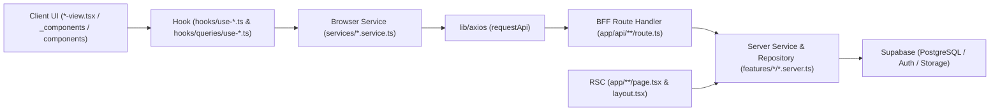

# Panduan Lengkap Arsitektur & Cara Coding Project Next.js (`App Router + TanStack Query + Supabase + Zod`)

Dokumen ini adalah blueprint teknis lengkap untuk membangun project **Next.js App Router** baru dengan struktur folder, library, kontrak arsitektur, pola coding, dan quality gate yang **identik** dengan repository **Resep Oma Kueh**.

---

## Daftar Isi

1. [Stack & Versi Library](#1-stack--versi-library)
2. [Prinsip Arsitektur & Boundary Layer](#2-prinsip-arsitektur--boundary-layer)
3. [Struktur Folder Lengkap](#3-struktur-folder-lengkap)
4. [Aturan Penempatan File & Pemecahan Komponen](#4-aturan-penempatan-file--pemecahan-komponen)
5. [Setup Konfigurasi Project Baru](#5-setup-konfigurasi-project-baru)
6. [Cara Coding Layer Fondasi (Config, Constants, Types, Zod, Utils)](#6-cara-coding-layer-fondasi-config-constants-types-zod-utils)
7. [Cara Coding Axios Transport & Error Handling](#7-cara-coding-axios-transport--error-handling)
8. [Cara Coding TanStack React Query (Provider, Helper, Query, Mutation)](#8-cara-coding-tanstack-react-query-provider-helper-query-mutation)
9. [Cara Coding Browser Service (`*.service.ts`)](#9-cara-coding-browser-service-servicets)
10. [Cara Coding Controller & Form Hook (`use-*.ts`, React Hook Form + Zod)](#10-cara-coding-controller--form-hook-use-ts-react-hook-form--zod)
11. [Cara Coding Client State dengan Zustand (`*.store.ts` + Provider)](#11-cara-coding-client-state-dengan-zustand-storets--provider)
12. [Cara Coding Supabase (Browser Auth, SSR Cookies, Public Read, Proxy)](#12-cara-coding-supabase-browser-auth-ssr-cookies-public-read-proxy)
13. [Cara Coding Server Domain, Repository & BFF Route Handler](#13-cara-coding-server-domain-repository--bff-route-handler)
14. [Cara Coding Page, Layout, View, UI Primitives & Common Components](#14-cara-coding-page-layout-view-ui-primitives--common-components)
15. [Konvensi Formatting, Linting, Testing & Quality Gate](#15-konvensi-formatting-linting-testing--quality-gate)
16. [Checklist Menambah Fitur Baru dari Nol](#16-checklist-menambah-fitur-baru-dari-nol)

---

## 1. Stack & Versi Library

Project ini memakai stack berikut (sesuai `package.json`):

| Kategori       | Library / Tool                                             | Versi                                       | Peran Utama                                                    |
| -------------- | ---------------------------------------------------------- | ------------------------------------------- | -------------------------------------------------------------- |
| Runtime        | Node.js / npm                                              | `24.x` / `11.x`                             | Runtime server & package manager                               |
| Framework      | `next`                                                     | `16.4.6`                                    | App Router, `cacheComponents`, Turbopack, `proxy.ts`           |
| UI Runtime     | `react`, `react-dom`                                       | `19.3.0`                                    | React 19 (`ComponentPropsWithRef`, `useId`, Suspense)          |
| Bahasa         | `typescript`                                               | `^5`                                        | Type safety `strict` + `noUnusedLocals` / `noUnusedParameters` |
| Server State   | `@tanstack/react-query`                                    | `5.107.1`                                   | Caching, deduplication, cancellation, optimistic/invalidation  |
| HTTP Client    | `axios`                                                    | `1.21.1`                                    | Transport BFF relatif (`/api/*`) terpusat di `src/lib/axios/`  |
| Validasi       | `zod`                                                      | `4.6.7`                                     | Schema env, API envelope, form, query params, response parsing |
| Form           | `react-hook-form`, `@hookform/resolvers`                   | `7.92.0` / `7.0.5`                          | State form kompleks + integrasi `zodResolver`                  |
| Client State   | `zustand`                                                  | `5.1.0`                                     | Store ringan dengan `persist` & `skipHydration: true`          |
| Backend & Auth | `@supabase/supabase-js`, `@supabase/ssr`                   | `2.119.0` / `0.12.7`                        | PostgreSQL, Auth cookies SSR, anonymous public read            |
| Styling        | `tailwindcss`, `@tailwindcss/turbopack`                    | `4.3.3`                                     | Tailwind CSS v4 + design tokens CSS                            |
| Class Helper   | `clsx`, `tailwind-merge`                                   | `2.1.1` / `3.7.0`                           | Helper `cn()` untuk komposisi className                        |
| Ikon & Toast   | `lucide-react`, `react-icons`, `react-toastify`            | `1.72.0` / `5.7.0` / `11.2.0`               | Ikon UI & notifikasi toast terpusat                            |
| Server Guard   | `server-only`                                              | `0.0.1`                                     | Mencegah modul server terbawa ke bundle client                 |
| Quality & Test | `eslint`, `prettier`, `knip`, `vitest`, `@playwright/test` | `^9`, `3.10.0`, `6.45.1`, `5.1.0`, `1.65.0` | Lint boundary, format, unused code, unit/DOM/server/E2E        |

---

## 2. Prinsip Arsitektur & Boundary Layer

Aturan alur data pada aplikasi ini **ketat** dan dijaga otomatis oleh ESLint custom rule (`tooling/eslint/architecture.mjs`) serta build test (`scripts/test-server-boundary.mjs`).



### Aturan Keras per Layer

1. **RSC (`page.tsx`, `layout.tsx`) -> Server Domain (`features/*/service.server.ts`)**
   - Server Component memanggil `service.server.ts` secara langsung. **Dilarang self-fetch** ke `/api/*` dari RSC.
   - `page.tsx` tidak boleh mengimpor `@supabase/*`, `lib/supabase/*`, `lib/axios`, `services/*`, atau memanggil `fetch()`.
2. **Client UI (`src/components/**`, `src/providers/**`, `src/app/**/_components/**`)**
   - Hanya merender JSX, menerima props bertipe (`interface`), dan memanggil hook (`src/hooks/*`).
   - **Dilarang** mengimpor `services/*`, `lib/axios`, `lib/supabase/*`, `axios`, `@supabase/*`, `server-only`, `features/*`, atau memanggil `fetch()`.
   - Wajib **named export** (`export function MyComponent`), dilarang `export default` di folder komponen/provider.
3. **Hooks (`src/hooks/use-*.ts` & `src/hooks/queries/use-*.ts`)**
   - `hooks/queries/` fokus pada `useQuery` dan `useMutation` TanStack Query yang memanggil `services/*.service.ts`.
   - `hooks/use-*.ts` berisi orkestrasi state UI, form (`react-hook-form`), URL params, toast, dan menggabungkan beberapa query/mutation hook.
   - **Dilarang** mengimpor `axios`, `lib/axios`, `lib/supabase`, `@supabase/*`, memanggil `fetch()`, atau mengimpor barrel `src/hooks/index.ts`.
4. **Browser Services (`src/services/*.service.ts`)**
   - Satu-satunya layer client yang berkomunikasi dengan BFF melalui `requestApi` dari `@/lib/axios`.
   - **Dilarang** mengimpor `axios` langsung, `@tanstack/react-query`, `@supabase/*`, `lib/supabase`, `features/*`, `hooks/*`, `components/*`, atau memanggil `fetch()`.
5. **Pure Modules (`constants/`, `types/`, `utils/`, `validations/`)**
   - Harus 100% pure (tanpa side-effect jaringan/state). Dilarang mengimpor `axios`, `@supabase/*`, `@tanstack/react-query`, `features/`, `hooks/`, `components/`, `providers/`, `services/`, atau `lib/`.
6. **Server-Only Modules (`*.server.ts`, `src/features/`, `lib/supabase/server.ts`, `lib/supabase/proxy.ts`)**
   - Wajib mengimpor `'server-only'` di baris pertama.
   - **Dilarang** diekspor ulang melalui barrel `index.ts` (selalu impor langsung path file-nya) agar client bundle tidak menarik kode server secara transitif.

---

## 3. Struktur Folder Lengkap

### A. Struktur Root Project

```text
my-nextjs-app/
├── docs/                           # Dokumentasi arsitektur, database, keamanan, & panduan
├── public/                         # Aset statis publik (ikon, gambar statis)
├── scripts/                        # Script CI/tooling (test-eslint-boundaries.mjs, test-server-boundary.mjs, db scripts)
├── src/                            # Seluruh source code aplikasi
├── supabase/                       # Migrations, seed, & pgTAP tests (jika pakai Supabase CLI lokal)
├── tests/                          # Automated tests
│   ├── unit/                       # Pure unit test (environment: node)
│   ├── server/                     # Server domain/handler test (environment: node, alias server-only empty)
│   ├── dom/                        # Component/hook DOM test (environment: jsdom)
│   ├── e2e/                        # Playwright E2E + accessibility (@axe-core/playwright)
│   └── setup-dom.ts                # Setup Testing Library / jsdom
├── tooling/
│   └── eslint/
│       └── architecture.mjs        # Custom ESLint rule untuk menjaga boundary antar layer
├── .env.example                    # Template environment variable non-rahasia
├── .prettierrc                     # Aturan formatting Prettier + prettier-plugin-tailwindcss
├── eslint.config.mjs               # Konfigurasi ESLint Flat Config
├── knip.jsonc                      # Konfigurasi deteksi file/export tidak terpakai
├── next.config.ts                  # Konfigurasi Next.js 16 (cacheComponents, headers, images, turbopack)
├── package.json                    # Dependencies & npm scripts
├── playwright.config.ts            # Konfigurasi Playwright
├── tsconfig.json                   # TypeScript strict + alias @/* -> ./src/*
└── vitest.config.mts               # Konfigurasi Vitest multi-project (unit, server, dom)
```

### B. Struktur Lengkap `src/`

```text
src/
├── app/                            # Next.js App Router: layout, page tipis, BFF API, _components lokal
│   ├── (site)/                     # Route group publik dengan layout storefront bersama
│   │   ├── _components/            # Komponen khusus root `/` (misal: home-view.tsx, hero-section.tsx)
│   │   ├── menu/
│   │   │   ├── _components/        # menu-view.tsx, menu-filter-panel.tsx, menu-results-section.tsx
│   │   │   ├── loading.tsx         # Route loading skeleton
│   │   │   └── page.tsx            # Server page tipis (RSC)
│   │   ├── error.tsx               # Error boundary segmen (site)
│   │   ├── layout.tsx              # Layout server (site) dengan Suspense + Provider
│   │   └── page.tsx                # Halaman Home `/`
│   ├── admin/                      # Area admin terautentikasi
│   │   ├── (dashboard)/            # Route group dashboard yang diproteksi session guard
│   │   │   ├── _components/        # admin-shell.tsx, admin-section-header.tsx, admin-forbidden-panel.tsx
│   │   │   ├── categories/
│   │   │   │   ├── _components/    # admin-categories-view.tsx, admin-category-card.tsx, editor-dialog.tsx
│   │   │   │   └── page.tsx
│   │   │   └── layout.tsx          # AdminDashboardLayout (auth guard di server)
│   │   └── login/
│   │       ├── _components/        # admin-login-view.tsx
│   │       └── page.tsx
│   ├── api/                        # BFF (Backend-for-Frontend) Route Handlers
│   │   ├── admin/                  # Endpoint privat admin (CSRF + requireApiAdmin + carrier response)
│   │   │   └── categories/
│   │   │       ├── [id]/route.ts
│   │   │       └── route.ts
│   │   ├── auth/                   # Endpoint login, logout, reset password
│   │   ├── catalog/route.ts        # Endpoint GET publik tervalidasi Zod
│   │   └── health/route.ts         # Endpoint healthcheck
│   ├── _components/                # Komponen khusus root app (misal: demo-banner.tsx)
│   ├── error.tsx                   # Global error boundary
│   ├── globals.css                 # Entry CSS: Tailwind v4 + tokens + base + primitives
│   ├── layout.tsx                  # RootLayout (fonts, metadata, ReactQueryProvider, ToastProvider)
│   ├── not-found.tsx
│   ├── robots.ts
│   └── sitemap.ts
├── components/                     # HANYA 2 subfolder: ui/ dan common/
│   ├── ui/                         # Primitif UI murni tanpa logic bisnis/API
│   │   ├── badge.tsx
│   │   ├── button.tsx
│   │   ├── card.tsx
│   │   ├── dialog.tsx
│   │   ├── drawer.tsx
│   │   ├── feedback.tsx
│   │   ├── form-field.tsx
│   │   ├── input.tsx
│   │   ├── modal-surface.tsx
│   │   ├── quantity.tsx
│   │   ├── select.tsx
│   │   ├── skeleton.tsx
│   │   └── textarea.tsx
│   └── common/                     # Komponen bisnis/layout reusable lintas 2+ modul/halaman
│       ├── cards/                  # stat-card.tsx, info-card.tsx
│       ├── commerce/               # menu-product-card.tsx, price-display.tsx
│       ├── feedback/               # empty-state.tsx, error-state.tsx, confirm-dialog.tsx, bakery-toast-container.tsx
│       └── layout/                 # site-header.tsx, site-footer.tsx, page-header.tsx, section-header.tsx
├── config/
│   ├── environment.client.ts       # Pembaca NEXT_PUBLIC_* eksplisit (client-safe)
│   ├── environment.server.ts       # Env server sensitif ('server-only', JANGAN masuk index.ts)
│   ├── index.ts                    # Hanya re-export client-safe config
│   └── parse-environment.ts        # Parser env Zod yang menyembunyikan nilai secret pada error
├── constants/
│   ├── app.constant.ts             # Nama app, URL lokal default
│   ├── copy.constant.ts            # ERROR_COPY & API_ERROR_CODES
│   ├── endpoint.constant.ts        # API_ENDPOINTS
│   ├── query-keys.constant.ts      # QUERY_KEYS, STALE_TIME, QUERY_LIMITS, adminScopedKey
│   ├── routes.constant.ts          # ROUTES
│   ├── ui.constant.ts              # Label UI umum (LOADING, CANCEL, dsb.)
│   ├── validation.constant.ts      # LIMITS (timeout, page size, panjang karakter)
│   └── <modul>.constant.ts         # Konstanta per domain (misal: catalog.constant.ts)
├── features/                       # Domain & repository server-only (dipanggil RSC & API Route)
│   ├── auth/
│   │   ├── admin-guard.server.ts   # requireAdminSession (RSC) & requireApiAdmin (API)
│   │   ├── csrf.server.ts          # assertSameOriginRequest
│   │   ├── errors.server.ts        # AuthError hierarchy
│   │   ├── http.server.ts          # Cookie carrier, createAuthJsonSuccess, createAuthJsonError
│   │   └── service.server.ts
│   └── <modul>/
│       ├── repository.server.ts    # Query Supabase murni + AbortSignal timeout
│       ├── service.server.ts       # Business logic, mapping, validasi Zod
│       └── errors.server.ts        # Domain error (opsional)
├── hooks/
│   ├── queries/                    # TanStack React Query hooks
│   │   ├── query-helpers.ts        # ADMIN_QUERY_DEFAULTS, unwrapData, invalidateQueryKeys
│   │   └── use-<modul>.ts          # useQuery & useMutation hooks
│   └── use-<fitur>.ts              # Controller / form / workflow hooks (tanpa barrel index.ts!)
├── lib/
│   ├── axios/
│   │   ├── index.ts                # Re-export requestApi
│   │   ├── instance.ts             # axios.create({ baseURL: '/api', timeout })
│   │   └── response-handler.ts     # requestApi() + Zod envelope validation + transportError()
│   ├── supabase/
│   │   ├── client.ts               # createBrowserAuthClient (khusus auth browser)
│   │   ├── no-store-fetch.ts       # Fetch wrapper dengan cache: 'no-store'
│   │   ├── proxy.ts                # refreshAuthSession() untuk proxy.ts
│   │   ├── public-read.server.ts   # createPublicReadClient() (anonymous SELECT-only)
│   │   └── server.ts               # createServerAuthClient(response?) (SSR cookie bridge)
│   ├── errors.ts                   # ApiClientError, shouldRetryRequest, extractAdminMutationError
│   ├── logger.server.ts            # Structured JSON logger ('server-only')
│   ├── query-client.ts             # createQueryClient()
│   ├── request-body.server.ts      # readBoundedUtf8Body() ('server-only')
│   ├── response.server.ts          # createSuccessResponse / createErrorResponse ('server-only')
│   └── toast.ts                    # notifySuccess / notifyError / notifyInfo / notifyWarning
├── providers/
│   ├── index.ts                    # Re-export client providers
│   ├── react-query-provider.tsx    # QueryClientProvider per mount
│   ├── toast-provider.tsx          # Toastify container provider
│   └── <domain>-provider.tsx       # Context + Zustand store provider (jika diperlukan)
├── services/
│   └── <modul>.service.ts          # HTTP client ke BFF via requestApi
├── stores/
│   └── <domain>.store.ts           # Zustand vanilla store + persist + Zod merge guard
├── styles/                         # CSS terpecah: tokens.css, base.css, primitives.css, layouts/, features/
├── types/
│   ├── api.ts                      # ApiSuccess<T>, ApiError, PaginatedData<T>, ApiErrorCode
│   ├── database.ts                 # Generated types dari Supabase CLI (jangan edit manual)
│   ├── index.ts
│   └── <modul>.ts                  # Interface/type domain
├── utils/
│   ├── api.ts                      # buildListParams()
│   ├── cn.ts                       # clsx + tailwind-merge
│   ├── index.ts
│   └── <modul>.ts                  # Pure formatter/helper functions
├── validations/
│   ├── api.schema.ts               # apiSuccessSchema, apiErrorSchema
│   ├── env.schema.ts               # publicEnvironmentSchema, supabaseEnvironmentSchema
│   └── <modul>.schema.ts           # Schema Zod request/response/form
└── proxy.ts                        # Next.js 16 proxy entry (pengganti middleware.ts)
```

---

## 4. Aturan Penempatan File & Pemecahan Komponen

### Keputusan Cepat: Taruh Komponen di Mana?

| Kondisi Komponen                                                                                                 | Lokasi Wajib                                  |
| ---------------------------------------------------------------------------------------------------------------- | --------------------------------------------- |
| Primitif UI murni tanpa logic bisnis/API (`Button`, `Input`, `Dialog`)                                           | `src/components/ui/<nama>.tsx`                |
| Dipakai lintas **2 atau lebih** halaman/modul berbeda (`PageHeader`, `ConfirmDialog`, `StatCard`, `ProductCard`) | `src/components/common/<kategori>/<nama>.tsx` |
| Dipakai bersama di beberapa sub-route dalam **1 segmen parent** (misal `products/new` & `products/[id]/edit`)    | `src/app/.../<parent>/_components/<nama>.tsx` |
| View utama sebuah route (`*-view.tsx`)                                                                           | `src/app/<route>/_components/<nama>-view.tsx` |
| Subkomponen khusus untuk 1 halaman saja                                                                          | `src/app/<route>/_components/<nama>.tsx`      |

> **Catatan Penting:** Folder `src/app/**/_components/` **murni berisi file `.tsx`**. Jika butuh mapper, helper, tipe, atau hook, taruh di `src/utils/`, `src/types/`, dan `src/hooks/`.

### Aturan Penamaan & Struktur Komponen

- **Nama file & folder:** selalu `kebab-case` (`menu-filter-panel.tsx`, `use-menu-filters.ts`, `catalog.service.ts`).
- **Nama simbol React:** selalu `PascalCase` dengan **named export** (`export function MenuFilterPanel(...)`).
- **Props interface:** wajib `interface <ComponentName>Props`, dan terima `className?: string` lalu gabungkan memakai `cn(...)`. (Provider tanpa elemen DOM hanya menerima `children`).
- **Pecah hingga unit single-responsibility:**
  - `page.tsx` hanya membaca `params` / `searchParams`, memanggil `connection()` + server service, lalu merender `*-view.tsx` dalam `<Suspense>`.
  - `*-view.tsx` hanya menghubungkan hook dengan komposisi subkomponen (header, toolbar, list/card, dialog, empty/error state).
  - Untuk list seragam, selalu `.map()` data ke komponen item dengan `key` yang stabil.

---

## 5. Setup Konfigurasi Project Baru

### 5.1. `tsconfig.json`

Mengaktifkan `strict`, `noUnusedLocals`, `noUnusedParameters`, dan alias `@/*`:

```json
{
  "compilerOptions": {
    "target": "ES2017",
    "lib": ["dom", "dom.iterable", "esnext"],
    "allowJs": false,
    "skipLibCheck": true,
    "strict": true,
    "noUnusedLocals": true,
    "noUnusedParameters": true,
    "noFallthroughCasesInSwitch": true,
    "noUncheckedSideEffectImports": true,
    "noEmit": true,
    "esModuleInterop": true,
    "module": "esnext",
    "moduleResolution": "bundler",
    "resolveJsonModule": true,
    "isolatedModules": true,
    "jsx": "react-jsx",
    "incremental": true,
    "plugins": [{ "name": "next" }],
    "paths": {
      "@/*": ["./src/*"]
    }
  },
  "include": [
    "next-env.d.ts",
    "**/*.ts",
    "**/*.tsx",
    ".next/types/**/*.ts",
    ".next/dev/types/**/*.ts",
    "**/*.mts"
  ],
  "exclude": ["node_modules"]
}
```

### 5.2. `.prettierrc`

```json
{
  "tabWidth": 2,
  "singleQuote": true,
  "semi": true,
  "trailingComma": "all",
  "arrowParens": "always",
  "endOfLine": "lf",
  "plugins": ["prettier-plugin-tailwindcss"],
  "tailwindStylesheet": "./src/app/globals.css"
}
```

### 5.3. `next.config.ts`

Mengaktifkan `cacheComponents: true` (Next.js 16), `partialPrefetching: true`, `poweredByHeader: false`, image formats modern, dan security/no-store headers:

```ts
import type { NextConfig } from 'next';

const nextConfig: NextConfig = {
  poweredByHeader: false,
  cacheComponents: true,
  partialPrefetching: true,
  images: {
    formats: ['image/avif', 'image/webp'],
    remotePatterns: [
      {
        protocol: 'https',
        hostname: '**.supabase.co',
      },
    ],
  },
  turbopack: {
    rules: {
      '*.css': {
        loaders: ['@tailwindcss/turbopack'],
        as: '*.css',
      },
    },
  },
};

export default nextConfig;
```

### 5.4. `eslint.config.mjs` & `tooling/eslint/architecture.mjs`

Pastikan ESLint menegakkan `consistent-type-imports`, `no-explicit-any`, larangan `export default` di komponen, dan rule custom `boundaries`:

```js
// eslint.config.mjs
import { defineConfig, globalIgnores } from 'eslint/config';
import nextVitals from 'eslint-config-next/core-web-vitals';
import nextTs from 'eslint-config-next/typescript';
import { architectureRule } from './tooling/eslint/architecture.mjs';

const eslintConfig = defineConfig([
  ...nextVitals,
  ...nextTs,
  {
    files: ['src/**/*.{ts,tsx}'],
    plugins: { app: { rules: { boundaries: architectureRule } } },
    rules: {
      'app/boundaries': 'error',
      '@typescript-eslint/consistent-type-imports': [
        'error',
        { prefer: 'type-imports', fixStyle: 'separate-type-imports' },
      ],
      '@typescript-eslint/no-explicit-any': 'error',
    },
  },
  {
    files: [
      'src/components/**/*.{ts,tsx}',
      'src/providers/**/*.{ts,tsx}',
      'src/app/**/_components/**/*.{ts,tsx}',
    ],
    rules: {
      'no-restricted-syntax': [
        'error',
        {
          selector: 'ExportDefaultDeclaration',
          message: 'Use a named component export.',
        },
      ],
    },
  },
  globalIgnores([
    '.next/**',
    'out/**',
    'build/**',
    'next-env.d.ts',
    'coverage/**',
    'playwright-report/**',
    'test-results/**',
  ]),
]);

export default eslintConfig;
```

### 5.5. `knip.jsonc`

Untuk mencegah dead files / unused exports, sambil mengecualikan `src/types/database.ts` yang di-generate CLI:

```jsonc
{
  "$schema": "https://unpkg.com/knip@6/schema.json",
  "ignore": ["src/types/database.ts"],
  "entry": [
    "src/app/**/*.{ts,tsx}",
    "tests/**/*.{test,spec}.{ts,tsx,mjs}",
    "scripts/*.mjs",
  ],
  "project": [
    "src/**/*.{ts,tsx,css}",
    "tests/**/*.{ts,tsx,mjs}",
    "tooling/**/*.mjs",
    "scripts/**/*.mjs",
    "*.config.{ts,mts,mjs}",
  ],
}
```

### 5.6. `src/app/globals.css`

Layer CSS terurut: Tailwind v4 -> Design Tokens -> Base Resets -> UI Primitives:

```css
@import 'tailwindcss';
@import '../styles/tokens.css';
@import '../styles/base.css';
@import '../styles/primitives.css';
```

---

## 6. Cara Coding Layer Fondasi (Config, Constants, Types, Zod, Utils)

### 6.1. Validasi Environment Client & Server (`src/config/` + `src/validations/env.schema.ts`)

Aturan penting di Next.js:

- Browser env (`NEXT_PUBLIC_*`) **harus direferensikan secara eksplisit** (`process.env.NEXT_PUBLIC_...`) agar Next melakukan build-time substitution.
- Server env **wajib** diberi `import 'server-only'` dan **tidak boleh** di-export lewat `src/config/index.ts`.
- Jangan pernah melempar raw `ZodError` yang membocorkan nilai secret ke error message — hanya laporkan nama key-nya (`EnvironmentConfigurationError`).

```ts
// src/config/environment.client.ts
import {
  publicEnvironmentSchema,
  supabaseEnvironmentSchema,
} from '@/validations/env.schema';
import { parseEnvironment } from './parse-environment';

export function getPublicEnvironment() {
  return parseEnvironment(publicEnvironmentSchema, {
    NEXT_PUBLIC_SITE_URL: process.env.NEXT_PUBLIC_SITE_URL,
    NEXT_PUBLIC_SUPABASE_URL: process.env.NEXT_PUBLIC_SUPABASE_URL,
    NEXT_PUBLIC_SUPABASE_PUBLISHABLE_KEY:
      process.env.NEXT_PUBLIC_SUPABASE_PUBLISHABLE_KEY,
  });
}

export function getSupabaseEnvironment() {
  const environment = getPublicEnvironment();
  return parseEnvironment(supabaseEnvironmentSchema, {
    url: environment.NEXT_PUBLIC_SUPABASE_URL,
    publishableKey: environment.NEXT_PUBLIC_SUPABASE_PUBLISHABLE_KEY,
  });
}
```

```ts
// src/config/environment.server.ts
import 'server-only';
import { z } from 'zod';
import { parseEnvironment } from '@/config/parse-environment';

export const serverEnvironmentSchema = z.strictObject({
  APP_ENV: z
    .enum(['development', 'test', 'staging', 'production'])
    .default('development'),
  // Tambahkan secret server lain di sini (API key eksternal, dll.)
});

export function getServerEnvironment() {
  return parseEnvironment(serverEnvironmentSchema, {
    APP_ENV: process.env.APP_ENV,
  });
}
```

### 6.2. Constants: Endpoint, Query Keys, Stale Time, Copy

Pisahkan konstanta agar tidak ada magic string di komponen, hook, atau service.

```ts
// src/constants/endpoint.constant.ts
export const API_ENDPOINTS = {
  BASE: '/api',
  CATEGORIES: '/categories',
  CATALOG: '/catalog',
  PRODUCT_DETAIL: (slug: string) => `/products/${encodeURIComponent(slug)}`,
  AUTH_LOGIN: '/auth/login',
  AUTH_LOGOUT: '/auth/logout',
  ADMIN_SESSION: '/admin/session',
  ADMIN_CATEGORIES: '/admin/categories',
  ADMIN_CATEGORY_DETAIL: (id: string) =>
    `/admin/categories/${encodeURIComponent(id)}`,
} as const;
```

```ts
// src/constants/query-keys.constant.ts
export interface AdminQueryIdentity {
  userId: string;
  role: string;
  branchId: string | null;
}

export function toAdminQueryIdentity(
  profile: AdminQueryIdentity | null | undefined,
): AdminQueryIdentity | null {
  return profile
    ? {
        userId: profile.userId,
        role: profile.role,
        branchId: profile.branchId,
      }
    : null;
}

// Scope key admin ke userId + role + branchId agar cache akun berbeda tidak pernah tercampur.
function adminScopedKey<
  const Scope extends string,
  const Extra extends readonly unknown[],
>(scope: Scope, identity: AdminQueryIdentity | null, ...extra: Extra) {
  return [
    'my-app',
    'admin',
    scope,
    identity?.userId ?? 'anon',
    identity?.role ?? 'none',
    identity?.branchId ?? 'none',
    ...extra,
  ] as const;
}

const ROOT_KEY = ['my-app'] as const;
const CATALOG_ALL = ['my-app', 'catalog'] as const;
const PRODUCT_DETAIL_ALL = ['my-app', 'product-detail'] as const;
const ADMIN_ROOT = ['my-app', 'admin'] as const;

export const QUERY_KEYS = {
  ROOT: ROOT_KEY,
  CATEGORIES: ['my-app', 'categories'] as const,
  CATALOG_ALL,
  CATALOG: (params: Record<string, string | number | null | undefined>) =>
    [...CATALOG_ALL, params] as const,
  PRODUCT_DETAIL_ALL,
  PRODUCT_DETAIL: (slug: string, branch: string | null) =>
    [...PRODUCT_DETAIL_ALL, slug, branch] as const,
  ADMIN_ROOT,
  ADMIN_SESSION: (identity: AdminQueryIdentity | null) =>
    adminScopedKey('session', identity),
  ADMIN_CATEGORIES: (identity: AdminQueryIdentity | null) =>
    adminScopedKey('categories', identity),
} as const;

export const STALE_TIME = {
  ADMIN_FRESH: 0,
  BRANCH_OFFERS: 30_000,
  PUBLIC: 60_000,
} as const;

export const QUERY_LIMITS = {
  RETRIES: 1,
  GC_TIME_MS: 300_000,
  ADMIN_GC_TIME_MS: 60_000,
} as const;
```

### 6.3. Envelope API Standard (`src/types/api.ts` & `src/validations/api.schema.ts`)

Seluruh endpoint BFF memakai format envelope seragam dengan `requestId` dan validasi `z.strictObject`:

```ts
// src/types/api.ts
import type { ERROR_COPY } from '@/constants/copy.constant';

export type ApiErrorCode = keyof typeof ERROR_COPY;

interface ApiMeta {
  page?: number;
  limit?: number;
  total?: number;
}

export interface ApiSuccess<T> {
  ok: true;
  data: T;
  requestId: string;
  meta?: ApiMeta;
}

export interface ApiError {
  ok: false;
  error: {
    code: ApiErrorCode;
    message: string;
    fieldErrors?: Record<string, string[]>;
  };
  requestId: string;
}

export interface PaginatedData<T> {
  items: T[];
  total: number;
  page: number;
  limit: number;
  totalPages: number;
}
```

```ts
// src/validations/api.schema.ts
import { z } from 'zod';
import { API_ERROR_CODES } from '@/constants/copy.constant';
import { LIMITS } from '@/constants/validation.constant';

const requestIdSchema = z.string().trim().min(1).max(LIMITS.REQUEST_ID_LENGTH);
const metaSchema = z.strictObject({
  page: z.int().positive().optional(),
  limit: z.int().min(1).max(LIMITS.PAGE_SIZE).optional(),
  total: z.int().nonnegative().optional(),
});

export function apiSuccessSchema<T>(dataSchema: z.ZodType<T>) {
  return z.strictObject({
    ok: z.literal(true),
    data: dataSchema,
    requestId: requestIdSchema,
    meta: metaSchema.optional(),
  });
}

export const apiErrorSchema = z.strictObject({
  ok: z.literal(false),
  error: z.strictObject({
    code: z.enum(API_ERROR_CODES),
    message: z.string().min(1).max(LIMITS.ERROR_MESSAGE_LENGTH),
    fieldErrors: z.record(z.string(), z.array(z.string())).optional(),
  }),
  requestId: requestIdSchema,
});
```

### 6.4. Pure Utils (`src/utils/cn.ts` & `src/utils/api.ts`)

```ts
// src/utils/cn.ts
import { clsx } from 'clsx';
import type { ClassValue } from 'clsx';
import { twMerge } from 'tailwind-merge';

export function cn(...inputs: ClassValue[]) {
  return twMerge(clsx(inputs));
}
```

```ts
// src/utils/api.ts
// Membersihkan undefined/null/string kosong (dan opsional 'all') sebelum dikirim sebagai query params.
export function buildListParams<
  T extends Record<string, string | number | boolean | null | undefined>,
>(
  params?: T,
  options?: { omitAll?: boolean },
): Record<string, string | number | boolean> | undefined {
  if (!params) return undefined;
  const clean: Record<string, string | number | boolean> = {};
  const omitAll = options?.omitAll ?? false;

  for (const [key, rawValue] of Object.entries(params)) {
    if (rawValue === undefined || rawValue === null) continue;
    if (typeof rawValue === 'string') {
      const trimmed = rawValue.trim();
      if (!trimmed) continue;
      if (omitAll && trimmed === 'all') continue;
      clean[key] = trimmed;
      continue;
    }
    clean[key] = rawValue;
  }

  return Object.keys(clean).length > 0 ? clean : undefined;
}
```

---

## 7. Cara Coding Axios Transport & Error Handling

Transport HTTP client dibuat **terpusat** di `src/lib/axios/` dengan prinsip:

- Selalu memakai path relatif ke BFF (`/api/...`), menolak URL absolut (`://` atau `//`).
- Memvalidasi response JSON dengan `apiSuccessSchema(dataSchema)` dan `apiErrorSchema`.
- Mempertahankan envelope utuh (`ApiSuccess<T>` termasuk `requestId` dan `meta`).
- Tidak menyamarkan error atau abort (`AbortSignal`), dan tidak memunculkan toast langsung di layer transport.

```ts
// src/lib/axios/instance.ts
import axios from 'axios';
import { API_ENDPOINTS } from '@/constants/endpoint.constant';
import { LIMITS } from '@/constants/validation.constant';

export const axiosInstance = axios.create({
  baseURL: API_ENDPOINTS.BASE,
  timeout: LIMITS.REQUEST_TIMEOUT_MS,
  headers: { Accept: 'application/json' },
});
```

```ts
// src/lib/axios/response-handler.ts
import { isAxiosError, isCancel } from 'axios';
import type { AxiosRequestConfig } from 'axios';
import type { z } from 'zod';
import { ApiClientError } from '@/lib/errors';
import type { ApiSuccess } from '@/types';
import { apiErrorSchema, apiSuccessSchema } from '@/validations/api.schema';
import { axiosInstance } from './instance';

type ApiRequestConfig = Omit<
  AxiosRequestConfig,
  'baseURL' | 'url' | 'validateStatus'
> & { url: string };

function failureFromBody(
  body: unknown,
  status?: number,
): ApiClientError | null {
  const result = apiErrorSchema.safeParse(body);
  return result.success
    ? new ApiClientError({
        ...result.data.error,
        requestId: result.data.requestId,
        status,
      })
    : null;
}

function transportError(error: unknown): ApiClientError {
  if (error instanceof ApiClientError) return error;
  if (isCancel(error)) return new ApiClientError({ code: 'CANCELED' });
  if (isAxiosError(error)) {
    const status = error.response?.status;
    const failure = failureFromBody(error.response?.data, status);
    if (failure) return failure;
    if (error.code === 'ECONNABORTED' || error.code === 'ETIMEDOUT') {
      return new ApiClientError({ code: 'TIMEOUT', status });
    }
    return new ApiClientError({
      code: status ? 'INVALID_RESPONSE' : 'NETWORK_ERROR',
      status,
    });
  }
  return new ApiClientError({ code: 'NETWORK_ERROR' });
}

export async function requestApi<T>(
  config: ApiRequestConfig,
  dataSchema: z.ZodType<T>,
): Promise<ApiSuccess<T>> {
  if (
    !config.url.startsWith('/') ||
    config.url.startsWith('//') ||
    config.url.includes('://')
  ) {
    throw new ApiClientError({ code: 'INVALID_REQUEST' });
  }
  try {
    const response = await axiosInstance.request<unknown>(config);
    const failure = failureFromBody(response.data, response.status);
    if (failure) throw failure;
    const parsed = apiSuccessSchema(dataSchema).safeParse(response.data);
    if (!parsed.success) {
      throw new ApiClientError({
        code: 'INVALID_RESPONSE',
        status: response.status,
      });
    }
    return parsed.data;
  } catch (error: unknown) {
    throw transportError(error);
  }
}
```

```ts
// src/lib/errors.ts
import { ERROR_COPY } from '@/constants/copy.constant';
import { QUERY_LIMITS } from '@/constants/query-keys.constant';
import type { ApiErrorCode } from '@/types';

interface ErrorDetails {
  code: ApiErrorCode;
  status?: number;
  requestId?: string;
  fieldErrors?: Record<string, string[]>;
  message?: string;
}

export class ApiClientError extends Error {
  readonly code: ApiErrorCode;
  readonly status?: number;
  readonly requestId?: string;
  readonly fieldErrors?: Record<string, string[]>;

  constructor(details: ErrorDetails) {
    super(details.message ?? ERROR_COPY[details.code]);
    this.name = 'ApiClientError';
    this.code = details.code;
    this.status = details.status;
    this.requestId = details.requestId;
    this.fieldErrors = details.fieldErrors;
  }
}

export function shouldRetryRequest(failureCount: number, error: Error) {
  if (error instanceof ApiClientError) {
    if (error.code === 'CANCELED' || error.code === 'INVALID_RESPONSE') {
      return false;
    }
    if (error.status && error.status >= 400 && error.status < 500) return false;
  }
  return failureCount < QUERY_LIMITS.RETRIES;
}

export function extractAdminMutationError(
  error: unknown,
  fallbackMessage: string,
) {
  if (error instanceof ApiClientError) {
    return {
      message: error.message || fallbackMessage,
      fields: error.fieldErrors ?? {},
      status: error.status,
      isConflict: error.status === 409,
    };
  }
  if (error instanceof Error && error.message) {
    return { message: error.message, fields: {}, isConflict: false };
  }
  return { message: fallbackMessage, fields: {}, isConflict: false };
}
```

---

## 8. Cara Coding TanStack React Query (Provider, Helper, Query, Mutation)

### 8.1. `QueryClient` Factory & `ReactQueryProvider`

`QueryClient` dibuat **per mount** di client provider dengan `useState(createQueryClient)` agar stabil saat re-render dan tidak pernah bocor antar request SSR.

```ts
// src/lib/query-client.ts
import { QueryClient } from '@tanstack/react-query';
import {
  QUERY_KEYS,
  QUERY_LIMITS,
  STALE_TIME,
} from '@/constants/query-keys.constant';
import { shouldRetryRequest } from './errors';

export function createQueryClient() {
  const client = new QueryClient({
    defaultOptions: {
      queries: {
        retry: shouldRetryRequest,
        refetchOnWindowFocus: true,
        gcTime: QUERY_LIMITS.GC_TIME_MS,
      },
      mutations: { retry: false },
    },
  });
  client.setQueryDefaults(QUERY_KEYS.ROOT, { staleTime: STALE_TIME.PUBLIC });
  return client;
}
```

```tsx
// src/providers/react-query-provider.tsx
'use client';

import { QueryClientProvider } from '@tanstack/react-query';
import type { ReactNode } from 'react';
import { useState } from 'react';
import { createQueryClient } from '@/lib/query-client';

interface ReactQueryProviderProps {
  children: ReactNode;
}

export function ReactQueryProvider({ children }: ReactQueryProviderProps) {
  const [client] = useState(createQueryClient);
  return <QueryClientProvider client={client}>{children}</QueryClientProvider>;
}
```

### 8.2. Shared Query Helpers (`src/hooks/queries/query-helpers.ts`)

```ts
import type { QueryClient } from '@tanstack/react-query';
import { QUERY_LIMITS, STALE_TIME } from '@/constants/query-keys.constant';
import type { ApiSuccess } from '@/types';

export const ADMIN_QUERY_DEFAULTS = {
  staleTime: STALE_TIME.ADMIN_FRESH,
  gcTime: QUERY_LIMITS.ADMIN_GC_TIME_MS,
  retry: false,
} as const;

export async function unwrapData<T>(
  request: Promise<ApiSuccess<T>>,
): Promise<T> {
  const response = await request;
  return response.data;
}

export async function invalidateQueryKeys(
  queryClient: QueryClient,
  keys: readonly (readonly unknown[])[],
): Promise<void> {
  await Promise.all(
    keys.map((queryKey) => queryClient.invalidateQueries({ queryKey })),
  );
}
```

### 8.3. Pola Coding Query Hook (`useQuery`)

Hal penting pada TanStack Query di project ini:

1. Selalu teruskan `{ signal }` dari `queryFn` ke browser service agar request dibatalkan otomatis saat filter berubah / unmount.
2. Gunakan `unwrapData(...)` sehingga komponen/hook menerima data domain bersih tanpa envelope `ok/data/requestId` (kecuali saat mutasi membutuhkan `response.data` atau metadata lain).
3. Untuk paginasi / filter, gunakan `placeholderData: keepPreviousData`.
4. Untuk SSR hydration: oper `initialData` **hanya jika parameter/branch/key query cocok** dengan data yang dirender server!

```ts
// src/hooks/queries/use-catalog.ts
'use client';

import { keepPreviousData, useQuery } from '@tanstack/react-query';
import { serializeCatalogQueryKey } from '@/constants/catalog.constant';
import { QUERY_KEYS, STALE_TIME } from '@/constants/query-keys.constant';
import { unwrapData } from '@/hooks/queries/query-helpers';
import { catalogService } from '@/services/catalog.service';
import type {
  CatalogDirectory,
  CatalogQueryInput,
  InitialCatalogSection,
  PublicCategoryDirectory,
} from '@/types/catalog';

export function useCategories(
  initial?: InitialCatalogSection<PublicCategoryDirectory>,
) {
  return useQuery({
    queryKey: QUERY_KEYS.CATEGORIES,
    queryFn: ({ signal }) => unwrapData(catalogService.getCategories(signal)),
    staleTime: STALE_TIME.PUBLIC,
    initialData: initial?.status === 'success' ? initial.data : undefined,
  });
}

export function useCatalog(
  params: CatalogQueryInput,
  initial?: {
    key: ReturnType<typeof serializeCatalogQueryKey>;
    result: InitialCatalogSection<CatalogDirectory>;
  },
) {
  const normalizedKey = serializeCatalogQueryKey(params);
  const isInitialMatch =
    initial?.result.status === 'success' &&
    JSON.stringify(initial.key) === JSON.stringify(normalizedKey);

  return useQuery({
    queryKey: QUERY_KEYS.CATALOG(normalizedKey),
    queryFn: ({ signal }) =>
      unwrapData(catalogService.getPaginated(params, signal)),
    staleTime: params.branch ? STALE_TIME.BRANCH_OFFERS : STALE_TIME.PUBLIC,
    placeholderData: keepPreviousData,
    initialData:
      isInitialMatch && initial?.result.status === 'success'
        ? initial.result.data
        : undefined,
  });
}
```

### 8.4. Pola Coding Mutation Hook (`useMutation`) & Cache Invalidation

- Definisikan daftar prefix key yang harus di-invalidate setelah mutasi berhasil (`CATALOG_INVALIDATION_KEYS`).
- Pada **login / logout**, bersihkan cache privat (`queryClient.removeQueries({ queryKey: QUERY_KEYS.ADMIN_ROOT })`) agar tidak terjadi kebocoran cache antar sesi admin.

```ts
// src/hooks/queries/use-admin-catalog.ts
'use client';

import { useMutation, useQuery, useQueryClient } from '@tanstack/react-query';
import {
  QUERY_KEYS,
  toAdminQueryIdentity,
} from '@/constants/query-keys.constant';
import {
  ADMIN_QUERY_DEFAULTS,
  invalidateQueryKeys,
  unwrapData,
} from '@/hooks/queries/query-helpers';
import { adminCatalogService } from '@/services/admin-catalog.service';
import type {
  AdminCategoryListResponse,
  CreateAdminCategoryInput,
  UpdateAdminCategoryInput,
} from '@/types/admin-catalog';
import type { AdminSessionProfile } from '@/types/auth';

const CATALOG_INVALIDATION_KEYS = [
  QUERY_KEYS.ADMIN_ROOT,
  QUERY_KEYS.CATEGORIES,
  QUERY_KEYS.CATALOG_ALL,
  QUERY_KEYS.PRODUCT_DETAIL_ALL,
] as const;

export function useAdminCategories(
  profile: AdminSessionProfile,
  initialData?: AdminCategoryListResponse,
) {
  return useQuery({
    queryKey: QUERY_KEYS.ADMIN_CATEGORIES(toAdminQueryIdentity(profile)),
    queryFn: ({ signal }) =>
      unwrapData(adminCatalogService.getCategories(signal)),
    initialData,
    enabled: profile.role === 'owner',
    ...ADMIN_QUERY_DEFAULTS,
  });
}

export function useCreateAdminCategory() {
  const queryClient = useQueryClient();

  return useMutation({
    mutationFn: (payload: CreateAdminCategoryInput) =>
      adminCatalogService.createCategory(payload),
    onSuccess: () =>
      invalidateQueryKeys(queryClient, CATALOG_INVALIDATION_KEYS),
  });
}

export function useUpdateAdminCategory() {
  const queryClient = useQueryClient();

  return useMutation({
    mutationFn: ({
      id,
      payload,
    }: {
      id: string;
      payload: UpdateAdminCategoryInput;
    }) => adminCatalogService.updateCategory(id, payload),
    onSuccess: () =>
      invalidateQueryKeys(queryClient, CATALOG_INVALIDATION_KEYS),
  });
}
```

Contoh cache clearing saat login/logout (`src/hooks/queries/use-admin-auth.ts`):

```ts
export function useAdminLogin() {
  const queryClient = useQueryClient();

  return useMutation({
    mutationFn: (payload: LoginRequest) => authService.login(payload),
    onSuccess: (response) => {
      queryClient.removeQueries({ queryKey: QUERY_KEYS.ADMIN_ROOT });
      const { profile } = response.data;
      queryClient.setQueryData(
        QUERY_KEYS.ADMIN_SESSION(toAdminQueryIdentity(profile)),
        profile,
      );
    },
  });
}

export function useAdminLogout() {
  const queryClient = useQueryClient();

  return useMutation({
    mutationFn: () => authService.logout(),
    onSuccess: () => {
      queryClient.removeQueries({ queryKey: QUERY_KEYS.ADMIN_ROOT });
    },
  });
}
```

---

## 9. Cara Coding Browser Service (`*.service.ts`)

Browser service diekspor sebagai **object literal** (bukan class), setiap method memanggil `requestApi(config, responseZodSchema)` dan menerima opsional `signal?: AbortSignal`.

```ts
// src/services/catalog.service.ts
import { API_ENDPOINTS } from '@/constants/endpoint.constant';
import { requestApi } from '@/lib/axios';
import type { CatalogQueryInput } from '@/types/catalog';
import { buildListParams } from '@/utils/api';
import {
  catalogDirectorySchema,
  productDetailSchema,
  publicCategoryDirectorySchema,
} from '@/validations/catalog.schema';

export const catalogService = {
  getCategories: (signal?: AbortSignal) =>
    requestApi(
      {
        url: API_ENDPOINTS.CATEGORIES,
        method: 'GET',
        signal,
      },
      publicCategoryDirectorySchema,
    ),

  getPaginated: (params: CatalogQueryInput = {}, signal?: AbortSignal) =>
    requestApi(
      {
        url: API_ENDPOINTS.CATALOG,
        method: 'GET',
        params: buildListParams(params),
        signal,
      },
      catalogDirectorySchema,
    ),

  getBySlug: (slug: string, branch?: string | null, signal?: AbortSignal) =>
    requestApi(
      {
        url: API_ENDPOINTS.PRODUCT_DETAIL(slug),
        method: 'GET',
        params: buildListParams({ branch }),
        signal,
      },
      productDetailSchema,
    ),
};
```

Untuk service mutasi (POST/PATCH/DELETE), kirim `data: payload`:

```ts
// Contoh method di src/services/admin-catalog.service.ts
createCategory: (payload: CreateAdminCategoryInput, signal?: AbortSignal) =>
  requestApi(
    {
      url: API_ENDPOINTS.ADMIN_CATEGORIES,
      method: 'POST',
      data: payload,
      signal,
    },
    adminCategoryDetailResponseSchema,
  ),
```

---

## 10. Cara Coding Controller & Form Hook (`use-*.ts`, React Hook Form + Zod)

View (`*-view.tsx`) dijaga setipis mungkin dengan memindahkan seluruh state, validasi, mutasi, dan side-effect ke controller hook di `src/hooks/use-*.ts`.

### Pola A: Form dengan `react-hook-form` + `zodResolver` + `ApiClientError`

```ts
// src/hooks/use-admin-login-flow.ts
'use client';

import { zodResolver } from '@hookform/resolvers/zod';
import { useRouter } from 'next/navigation';
import { useState } from 'react';
import { useForm } from 'react-hook-form';
import { AUTH_COPY } from '@/constants/auth.constant';
import { useAdminLogin } from '@/hooks/queries/use-admin-auth';
import { ApiClientError } from '@/lib/errors';
import { notifySuccess } from '@/lib/toast';
import type { LoginRequest } from '@/types/auth';
import { loginRequestSchema } from '@/validations/auth.schema';

export function useAdminLoginFlow({ nextPath }: { nextPath: string }) {
  const router = useRouter();
  const [serverError, setServerError] = useState<string | null>(null);
  const loginMutation = useAdminLogin();

  const loginForm = useForm<LoginRequest>({
    resolver: zodResolver(loginRequestSchema),
    defaultValues: { email: '', password: '', next: nextPath },
  });

  async function onSubmitLogin(values: LoginRequest) {
    setServerError(null);
    try {
      const result = await loginMutation.mutateAsync({
        email: values.email,
        password: values.password,
        next: nextPath,
      });
      notifySuccess('Berhasil masuk ke panel admin.', {
        toastId: 'admin-login-success',
      });
      router.replace(result.data.redirectTo);
      router.refresh();
    } catch (err) {
      if (err instanceof ApiClientError) {
        if (err.fieldErrors?.email?.[0]) {
          loginForm.setError('email', { message: err.fieldErrors.email[0] });
        }
        if (err.fieldErrors?.password?.[0]) {
          loginForm.setError('password', {
            message: err.fieldErrors.password[0],
          });
        }
        setServerError(err.message);
        return;
      }
      setServerError(AUTH_COPY.ERROR_INVALID_CREDENTIALS);
    }
  }

  return {
    serverError,
    loginForm,
    isLoginSubmitting:
      loginForm.formState.isSubmitting || loginMutation.isPending,
    onSubmitLogin,
  };
}
```

### Pola B: CRUD Manager Hook dengan Optimistic Concurrency (`409 Conflict`) & Toast

Untuk dialog/form CRUD admin yang mengelola daftar, dialog create/edit, dialog konfirmasi archive, error per field (`fieldErrors`), dan `expectedUpdatedAt`:

- Lakukan `schema.safeParse(candidate)` sebelum `mutateAsync`.
- Tangkap error dengan `extractAdminMutationError(err, fallbackMessage)`:
  - Jika `err.code === 'CONFLICT'` (HTTP 409), tampilkan banner konflik agar user bisa reload data terbaru.
  - Petakan `parsed.fields` ke `fieldErrors` untuk komponen `FormField`.
  - Panggil `notifySuccess(...)` / `notifyError(...)` di hook ini (**bukan** di service atau Axios).

### Pola C: URL Filter & Debounced Search Hook (`useMenuFilters`)

- Baca URL params menggunakan `useSearchParams()` dan `usePathname()`.
- Simpan draft input teks (`searchDraft`) di `useState`, lalu debounce dengan `setTimeout` (`CATALOG_LIMITS.DEBOUNCE_MS`) dan sinkronkan ke URL dengan `window.history.replaceState(null, '', nextUrl)` agar tidak memicu full RSC navigation berulang saat mengetik.
- Gabungkan hasil parameter tersebut menjadi `queryParams` yang dioper ke `useCatalog(queryParams, initialCatalog)`.

---

## 11. Cara Coding Client State dengan Zustand (`*.store.ts` + Provider)

Aturan Zustand di project ini:

- Gunakan `createStore` dari `zustand/vanilla` untuk store yang terikat ke Provider, atau `create` dengan `persist`.
- **Wajib** set `skipHydration: true` dan lakukan rehydrate di dalam `useEffect` agar HTML SSR dan render client pertama **100% cocok** (bebas React hydration mismatch).
- **Wajib** validasi ulang isi `localStorage` pada `merge` menggunakan `schema.safeParse(stored)` agar data storage yang rusak/kadaluarsa aman fallback ke default.

```ts
// src/stores/branch.store.ts
import { createStore } from 'zustand/vanilla';
import { createJSONStorage, persist } from 'zustand/middleware';
import { BRANCH } from '@/constants/site.constant';
import { branchPreferenceSchema } from '@/validations/branch.schema';

interface BranchPreference {
  selectedBranchId: string | null;
  setSelectedBranchId: (id: string | null) => void;
}

export function createBranchStore() {
  return createStore<BranchPreference>()(
    persist(
      (set) => ({
        selectedBranchId: null,
        setSelectedBranchId: (selectedBranchId) => set({ selectedBranchId }),
      }),
      {
        name: BRANCH.STORAGE_KEY,
        version: 1,
        storage: createJSONStorage(() => ({
          getItem: (name) => localStorage.getItem(name),
          setItem: (name, value) => localStorage.setItem(name, value),
          removeItem: (name) => localStorage.removeItem(name),
        })),
        skipHydration: true,
        partialize: (state) => ({ selectedBranchId: state.selectedBranchId }),
        merge: (stored, current) => {
          const parsed = branchPreferenceSchema.safeParse(stored);
          return {
            ...current,
            selectedBranchId: parsed.success
              ? parsed.data.selectedBranchId
              : null,
          };
        },
      },
    ),
  );
}
```

Rehidrasi di Provider (`src/providers/branch-provider.tsx`):

```tsx
useEffect(() => {
  let mounted = true;
  void Promise.resolve(store.persist.rehydrate())
    .then(() => {
      if (mounted) setHydrated(true);
    })
    .catch(() => {
      if (mounted) setHydrated(true);
    });
  return () => {
    mounted = false;
  };
}, [store]);
```

---

## 12. Cara Coding Supabase (Browser Auth, SSR Cookies, Public Read, Proxy)

Project memisahkan **4 konteks Supabase** secara ketat untuk keamanan RLS & cookie isolation:

### 12.1. Browser Auth Adapter (`src/lib/supabase/client.ts`)

Hanya untuk auth browser jika diperlukan (business CRUD **tetap lewat BFF**):

```ts
'use client';

import { createBrowserClient } from '@supabase/ssr';
import { getSupabaseEnvironment } from '@/config/environment.client';
import type { Database } from '@/types/database';

export function createBrowserAuthClient() {
  const { url, publishableKey } = getSupabaseEnvironment();
  return createBrowserClient<Database>(url, publishableKey);
}
```

### 12.2. Public Read Client (`src/lib/supabase/public-read.server.ts`)

Client anonim khusus pembacaan data publik. Tidak pernah membaca cookie atau session admin, memaksa header `apikey` & `Authorization` ke publishable key, `credentials: 'omit'`, dan `cache: 'no-store'`:

```ts
import 'server-only';

import { createClient } from '@supabase/supabase-js';
import { getSupabaseEnvironment } from '@/config/environment.client';
import type { Database } from '@/types/database';

function createAnonymousSupabaseClient() {
  const { url, publishableKey } = getSupabaseEnvironment();
  return createClient<Database>(url, publishableKey, {
    auth: {
      persistSession: false,
      autoRefreshToken: false,
      detectSessionInUrl: false,
    },
    global: {
      fetch: (input, init) => {
        const headers = new Headers(
          input instanceof Request ? input.headers : undefined,
        );
        new Headers(init?.headers).forEach((value, name) =>
          headers.set(name, value),
        );
        headers.delete('cookie');
        headers.set('apikey', publishableKey);
        headers.set('Authorization', `Bearer ${publishableKey}`);
        return fetch(input, {
          ...init,
          headers,
          credentials: 'omit',
          cache: 'no-store',
        });
      },
    },
  });
}

export function createPublicReadClient() {
  return createAnonymousSupabaseClient();
}
```

### 12.3. Server Auth Client (`src/lib/supabase/server.ts`)

- Dipakai di RSC (tanpa argumen `response` -> read-only) dan di BFF Route Handler (wajib mengoper `NextResponse` agar cookie refresh dan header `Cache-Control` diteruskan ke browser).
- Menggunakan `noStoreFetch` (`cache: 'no-store'`).

```ts
import 'server-only';

import { createServerClient } from '@supabase/ssr';
import { cookies } from 'next/headers';
import type { NextResponse } from 'next/server';
import { getSupabaseEnvironment } from '@/config/environment.client';
import type { Database } from '@/types/database';
import { noStoreFetch } from './no-store-fetch';

export async function createServerAuthClient(response?: NextResponse) {
  const { url, publishableKey } = getSupabaseEnvironment();
  response?.headers.set('Cache-Control', 'private, no-store');
  const cookieStore = await cookies();

  return createServerClient<Database>(url, publishableKey, {
    global: { fetch: noStoreFetch },
    cookies: {
      getAll: () => cookieStore.getAll(),
      setAll: (cookiesToSet, headers) => {
        if (!response) return;
        cookiesToSet.forEach(({ name, value, options }) => {
          cookieStore.set(name, value, options);
          response.cookies.set(name, value, options);
        });
        Object.entries(headers).forEach(([name, value]) =>
          response.headers.set(name, value),
        );
      },
    },
  });
}
```

### 12.4. Proxy Session Refresh (`src/lib/supabase/proxy.ts` & `src/proxy.ts`)

Di Next.js 16, file proxy menggunakan `src/proxy.ts`. Fungsinya **hanya refresh token** (`client.auth.getClaims()`), bukan otorisasi akhir (otorisasi role/revocation tetap dicek di `admin-guard.server.ts`). `matcher` memakai array string literal dan **tidak** memasukkan jalur publik.

```ts
// src/proxy.ts
import type { NextRequest } from 'next/server';
import { refreshAuthSession } from '@/lib/supabase/proxy';

export function proxy(request: NextRequest) {
  return refreshAuthSession(request);
}

export const config = {
  matcher: [
    '/admin/:path*',
    '/auth/:path*',
    '/api/admin/:path*',
    '/api/auth/:path*',
  ],
};
```

---

## 13. Cara Coding Server Domain, Repository & BFF Route Handler

### 13.1. Repository (`src/features/<modul>/repository.server.ts`)

- Selalu diawali `import 'server-only'`.
- Setiap query Supabase wajib memiliki timeout deadline (`AbortSignal.timeout`) yang digabung dengan `signal` dari caller (`AbortSignal.any([signal, deadline])`).
- Gunakan `.retry(false)` dan pilih kolom secara eksplisit (hindari `select('*')`).

```ts
// src/features/catalog/repository.server.ts
import 'server-only';
import { CATALOG_LIMITS } from '@/constants/catalog.constant';
import { createPublicReadClient } from '@/lib/supabase/public-read.server';

function withDeadline(signal?: AbortSignal) {
  const deadline = AbortSignal.timeout(CATALOG_LIMITS.READ_TIMEOUT_MS);
  return signal ? AbortSignal.any([signal, deadline]) : deadline;
}

export async function readPublishedCategories(signal?: AbortSignal) {
  const { data, error } = await createPublicReadClient()
    .from('categories')
    .select('id,name,slug,description,sort_order,status')
    .eq('status', 'published')
    .retry(false)
    .order('sort_order')
    .order('name')
    .order('id')
    .limit(CATALOG_LIMITS.MAX_CATEGORIES_READ)
    .abortSignal(withDeadline(signal));
  if (error) throw new Error('Categories read unavailable');
  return data;
}
```

### 13.2. Server Service (`src/features/<modul>/service.server.ts`)

Memanggil repository, menerapkan business rules/sorting/filtering, dan memvalidasi bentuk output menggunakan schema Zod sebelum dikembalikan ke RSC atau Route Handler.

### 13.3. Public BFF Route Handler (`src/app/api/<modul>/route.ts`)

- Generate `requestId = crypto.randomUUID()`.
- Validasi allowlist query parameter (tolak parameter tidak dikenal atau duplikat).
- Parse input dengan Zod (`safeParse`), catat structured log (`logServerEvent`), dan bungkus response dengan `createSuccessResponse(schema, data, requestId)` (`Cache-Control: no-store`).

```ts
// src/app/api/catalog/route.ts (pola ringkas)
import { NextResponse } from 'next/server';
import { CATALOG_QUERY_PARAMS } from '@/constants/catalog.constant';
import { ERROR_COPY } from '@/constants/copy.constant';
import { getCatalog } from '@/features/catalog/service.server';
import { logServerEvent } from '@/lib/logger.server';
import { createSuccessResponse } from '@/lib/response.server';
import { apiErrorSchema } from '@/validations/api.schema';
import {
  catalogDirectorySchema,
  catalogQuerySchema,
} from '@/validations/catalog.schema';

const ALLOWED_PARAM_KEYS = new Set<string>(Object.values(CATALOG_QUERY_PARAMS));

export async function GET(request: Request) {
  const startedAt = Date.now();
  const requestId = crypto.randomUUID();
  const params = new URL(request.url).searchParams;

  for (const key of params.keys()) {
    if (!ALLOWED_PARAM_KEYS.has(key) || params.getAll(key).length > 1) {
      return NextResponse.json(
        apiErrorSchema.parse({
          ok: false,
          error: {
            code: 'INVALID_REQUEST',
            message: ERROR_COPY.INVALID_REQUEST,
          },
          requestId,
        }),
        { status: 400, headers: { 'Cache-Control': 'no-store' } },
      );
    }
  }

  const rawEntries: Record<string, string> = {};
  params.forEach((value, key) => {
    if (value.trim().length > 0) rawEntries[key] = value;
  });

  const parsed = catalogQuerySchema.safeParse(rawEntries);
  if (!parsed.success) {
    return NextResponse.json(
      apiErrorSchema.parse({
        ok: false,
        error: { code: 'INVALID_REQUEST', message: ERROR_COPY.INVALID_REQUEST },
        requestId,
      }),
      { status: 400, headers: { 'Cache-Control': 'no-store' } },
    );
  }

  try {
    const data = await getCatalog(parsed.data, {}, request.signal);
    logServerEvent({
      requestId,
      route: '/api/catalog',
      operation: 'list_catalog',
      status: 200,
      durationMs: Date.now() - startedAt,
      count: data.items.length,
    });
    return createSuccessResponse(catalogDirectorySchema, data, requestId);
  } catch {
    return NextResponse.json(
      apiErrorSchema.parse({
        ok: false,
        error: { code: 'UPSTREAM_ERROR', message: ERROR_COPY.UPSTREAM_ERROR },
        requestId,
      }),
      { status: 503, headers: { 'Cache-Control': 'no-store' } },
    );
  }
}
```

### 13.4. Protected Admin BFF Route Handler (`src/app/api/admin/<modul>/route.ts`)

Wajib menerapkan urutan pertahanan berikut:

1. `createCookieCarrierResponse()` untuk membawa cookie refresh Supabase.
2. Pada mutasi (`POST`, `PATCH`, `DELETE`): `assertSameOriginRequest(request)` (CSRF protection).
3. `requireApiAdmin({ roles: ['owner'], response: carrier })`.
4. `readBoundedJsonBody(request, MAX_BODY_BYTES)` (streaming chunk cap mencegah payload raksasa).
5. `parseWithSchema(schema, rawBody)`.
6. Kembalikan `createAuthJsonSuccess(data, responseSchema, requestId, carrier, status)` atau `createAuthJsonError(err, requestId, carrier)`.

---

## 14. Cara Coding Page, Layout, View, UI Primitives & Common Components

### 14.1. Root Layout (`src/app/layout.tsx`)

- Memuat font Google dengan `next/font/google` dan CSS variable (`--font-jakarta`, `--font-fraunces`).
- Validasi server environment saat boot (`getServerEnvironment()`).
- Membungkus `{children}` dengan `<ReactQueryProvider>` dan `<ToastProvider>`.

### 14.2. Server Page Tipis dengan Next.js 16 `connection()` & `<Suspense>`

Karena `cacheComponents: true` aktif, page dinamis yang membaca DB/request params wajib membungkus komponen async-nya dalam `<Suspense fallback={<Skeleton />}>` dan memanggil `await connection()` di dalam komponen async tersebut.

```tsx
// src/app/(site)/menu/page.tsx
import type { Metadata } from 'next';
import { connection } from 'next/server';
import { Suspense } from 'react';
import { SiteMenuSkeleton } from '../_components/skeletons/site-menu-skeleton';
import { MenuView } from './_components/menu-view';
import {
  CATALOG_COPY,
  serializeCatalogQueryKey,
} from '@/constants/catalog.constant';
import { getCatalog, getCategories } from '@/features/catalog/service.server';
import { parseCatalogSearchParams } from '@/utils/branch-url';

async function MenuContent({
  searchParams,
}: Pick<PageProps<'/menu'>, 'searchParams'>) {
  await connection();
  const resolvedParams = await searchParams;
  const initialQueryInput = parseCatalogSearchParams(resolvedParams);

  const [initialCategories, initialCatalogResult] = await Promise.all([
    getCategories()
      .then((data) => ({ status: 'success' as const, data }))
      .catch(() => ({ status: 'error' as const })),
    getCatalog(initialQueryInput)
      .then((data) => ({ status: 'success' as const, data }))
      .catch(() => ({ status: 'error' as const })),
  ]);

  return (
    <MenuView
      initialCategories={initialCategories}
      initialCatalog={{
        key: serializeCatalogQueryKey(initialQueryInput),
        result: initialCatalogResult,
      }}
    />
  );
}

export default function MenuPage({ searchParams }: PageProps<'/menu'>) {
  return (
    <Suspense fallback={<SiteMenuSkeleton />}>
      <MenuContent searchParams={searchParams} />
    </Suspense>
  );
}
```

Untuk halaman admin terproteksi (`src/app/admin/(dashboard)/categories/page.tsx`), panggil `await requireAdminSession(ROUTES.ADMIN_CATEGORIES)` sebelum membaca data awal dan periksa role sebelum merender view.

### 14.3. View Tipis (`*-view.tsx`)

`MenuView` / `AdminCategoriesView` berada di `_components/`, bertanda `'use client'`, memanggil controller hook (`useMenuFilters`, `useAdminCategoriesManager`), dan hanya merangkai subkomponen kecil:

```tsx
// src/app/(site)/menu/_components/menu-view.tsx (pola ringkas)
'use client';

import { PageHeader } from '@/components/common/layout/page-header';
import { Card } from '@/components/ui/card';
import { CATALOG_COPY } from '@/constants/catalog.constant';
import { useMenuFilters } from '@/hooks/use-menu-filters';
import '@/styles/features/menu.css';
import { cn } from '@/utils';
import { MenuFilterPanel } from './menu-filter-panel';
import { MenuResultsSection } from './menu-results-section';

interface MenuViewProps {
  initialCategories: InitialCatalogSection<PublicCategoryDirectory>;
  initialCatalog: {
    key: ReturnType<typeof serializeCatalogQueryKey>;
    result: InitialCatalogSection<CatalogDirectory>;
  };
  className?: string;
}

export function MenuView({
  initialCategories,
  initialCatalog,
  className,
}: MenuViewProps) {
  const menu = useMenuFilters({ initialCategories, initialCatalog });

  return (
    <main className={cn('content-container menu-page-main', className)}>
      <PageHeader title={CATALOG_COPY.TITLE} subtitle={CATALOG_COPY.SUBTITLE} />
      <div className="menu-layout-grid">
        <aside className="menu-sidebar-desktop">
          <Card className="menu-filter-card">
            <MenuFilterPanel
              idPrefix="desktop"
              categories={menu.categories}
              filters={menu.filterState}
              onSearchDraftChange={menu.setSearchDraft}
              onResetFilters={menu.handleResetFilters}
            />
          </Card>
        </aside>
        <MenuResultsSection
          catalogData={menu.catalogData}
          isCatalogLoading={menu.isCatalogLoading}
          isCatalogError={menu.isCatalogError}
          onRetry={menu.handleRetryCatalog}
        />
      </div>
    </main>
  );
}
```

### 14.4. Primitif UI (`src/components/ui/`)

- Gunakan `ComponentPropsWithRef<'button'>` / `'input'` (React 19 native ref prop).
- Sertakan semantic accessibility (`aria-busy`, `aria-invalid`, `aria-describedby`, `role="alert"`).
- **Zero** domain state, **zero** API/toast calls.

```tsx
// src/components/ui/button.tsx
import { LoaderCircle } from 'lucide-react';
import type { ComponentPropsWithRef } from 'react';
import { UI_COPY } from '@/constants/ui.constant';
import { cn } from '@/utils';

export type ButtonVariant = 'primary' | 'secondary' | 'ghost';
export type ButtonSize = 'sm' | 'md' | 'lg';

export function buttonStyles(
  variant: ButtonVariant = 'primary',
  size: ButtonSize = 'md',
  className?: string,
) {
  return cn(
    'ui-button',
    `ui-button--${variant}`,
    size !== 'md' && `ui-button--${size}`,
    className,
  );
}

interface ButtonProps extends ComponentPropsWithRef<'button'> {
  variant?: ButtonVariant;
  size?: ButtonSize;
  loading?: boolean;
  loadingLabel?: string;
}

export function Button({
  className,
  variant = 'primary',
  size = 'md',
  loading = false,
  loadingLabel = UI_COPY.LOADING,
  disabled,
  children,
  type = 'button',
  ...props
}: ButtonProps) {
  return (
    <button
      {...props}
      type={type}
      className={buttonStyles(variant, size, className)}
      disabled={disabled || loading}
      aria-busy={loading || undefined}
    >
      {loading ? (
        <>
          <LoaderCircle size={18} aria-hidden="true" />
          {loadingLabel}
        </>
      ) : (
        children
      )}
    </button>
  );
}
```

```tsx
// src/components/ui/form-field.tsx (render-prop pattern dengan useId)
'use client';

import { useId } from 'react';
import type { ReactNode } from 'react';
import { cn } from '@/utils';

interface FieldControlProps {
  id: string;
  'aria-describedby'?: string;
  'aria-invalid'?: true;
  required?: boolean;
}

interface FormFieldProps {
  id?: string;
  label: string;
  helper?: string;
  error?: string;
  required?: boolean;
  className?: string;
  children: (props: FieldControlProps) => ReactNode;
}

export function FormField({
  id: providedId,
  label,
  helper,
  error,
  required,
  className,
  children,
}: FormFieldProps) {
  const generatedId = useId();
  const id = providedId ?? generatedId;
  const describedBy =
    [helper && `${id}-helper`, error && `${id}-error`]
      .filter(Boolean)
      .join(' ') || undefined;

  return (
    <div className={cn('ui-field', className)}>
      <label htmlFor={id} className="ui-field-label">
        <span>{label}</span>
        {required ? (
          <span className="ui-field-required" aria-hidden="true">
            *
          </span>
        ) : null}
      </label>
      {children({
        id,
        'aria-describedby': describedBy,
        'aria-invalid': error ? true : undefined,
        required,
      })}
      {helper ? (
        <p id={`${id}-helper`} className="ui-field-note">
          {helper}
        </p>
      ) : null}
      {error ? (
        <p id={`${id}-error`} className="ui-field-error" role="alert">
          {error}
        </p>
      ) : null}
    </div>
  );
}
```

### 14.5. Common Components (`src/components/common/`)

Gunakan slot props bertipe (`subtitle`, `badges`, `aside`, `alert`, `children`) agar komponen fleksibel dipakai lintas halaman tanpa duplikasi markup:

```tsx
// src/components/common/layout/page-header.tsx
import type { ReactNode } from 'react';
import { cn } from '@/utils';
import '@/styles/components/page-sections.css';

interface PageHeaderProps {
  title: string;
  subtitle?: ReactNode;
  badges?: ReactNode;
  aside?: ReactNode;
  alert?: ReactNode;
  children?: ReactNode;
  titleId?: string;
  headingAs?: 'h1' | 'h2';
  className?: string;
}

export function PageHeader({
  title,
  subtitle,
  badges,
  aside,
  alert,
  children,
  titleId,
  headingAs = 'h1',
  className,
}: PageHeaderProps) {
  const Heading = headingAs;

  return (
    <div
      className={cn(
        'content-header-block',
        aside && 'content-header-block--split',
        className,
      )}
    >
      {badges ? <div className="home-badge-row">{badges}</div> : null}
      <div className={cn(aside && 'content-header-row--split')}>
        <div>
          <Heading id={titleId} className="editorial-display">
            {title}
          </Heading>
          {subtitle ? <p className="editorial-lead">{subtitle}</p> : null}
        </div>
        {aside ?? null}
      </div>
      {alert ?? null}
      {children ?? null}
    </div>
  );
}
```

---

## 15. Konvensi Formatting, Linting, Testing & Quality Gate

### 15.1. Gaya Kode Standar

- **Indentasi:** 2 spasi, **single quotes** (`'...'`), **semicolon** wajib, **trailing comma** (`all`), **arrow parens** (`always`), **line ending** `lf`.
- Selalu gunakan `import type` untuk type/interface (ditegakkan oleh ESLint).
- Selalu gunakan alias `@/` untuk impor internal `src/` (relatif `.` hanya untuk sibling file di folder yang sama).
- Jangan membuat `any`, `@ts-ignore`, atau barrel `index.ts` yang tidak terpakai (`knip`).

### 15.2. Pemisahan Test Vitest (`vitest.config.mts`)

Test dipisah menjadi 3 project agar environment tetap bersih dan boundary `server-only` tidak bocor ke tes browser:

1. `unit` (`tests/unit/**/*.test.{ts,mjs}`, environment `node`) — pure functions, Zod schemas, store logic.
2. `server` (`tests/server/**/*.test.ts`, environment `node`, alias `'server-only'` ke `node_modules/server-only/empty.js`) — BFF Route Handlers, `features/*.server.ts`.
3. `dom` (`tests/dom/**/*.test.tsx`, environment `jsdom`, `setupFiles: ['tests/setup-dom.ts']`) — React components & hooks via Testing Library.

### 15.3. Pipeline Verification (`package.json`)

Sebelum menyelesaikan fitur atau melakukan commit, jalankan urutan pipeline berikut:

```powershell
npm run format        # Prettier write
npm run check         # Menjalankan seluruh gate berurutan:
# 1. npm run lint             -> ESLint + architecture boundaries + type-imports + no-any
# 2. npm run typecheck        -> next typegen && tsc --noEmit --noUnusedLocals --noUnusedParameters
# 3. npm test                 -> vitest run (unit + server + dom)
# 4. npm run test:boundaries  -> ESLint negative fixtures + Next webpack build check server-only
# 5. npm run lint:unused      -> knip (unused files/exports/dependencies)
# 6. npm run format:check     -> prettier --check .
# 7. npm run build            -> next build (Turbopack)

npm run test:e2e      # Playwright E2E + axe accessibility checks
```

---

## 16. Checklist Menambah Fitur Baru dari Nol

Saat membangun fitur/modul baru (misalnya modul `orders` atau `articles`), ikuti urutan bottom-up berikut agar type safety dan boundary selalu hijau:

1. **Konstanta & Copy (`src/constants/`)**
   - Tambah route di `routes.constant.ts`.
   - Tambah endpoint di `endpoint.constant.ts`.
   - Tambah key di `query-keys.constant.ts` (gunakan `adminScopedKey` jika data privat/admin).
   - Tambah copy/limit di `<modul>.constant.ts`.
2. **Types & Zod Validations (`src/types/`, `src/validations/`)**
   - Definisikan schema Zod input & output di `src/validations/<modul>.schema.ts`.
   - Definisikan interface/type di `src/types/<modul>.ts`.
3. **Server Repository & Service (`src/features/<modul>/`)**
   - Buat `repository.server.ts` (`import 'server-only'`, `createPublicReadClient()` atau `createServerAuthClient(response)`).
   - Buat `service.server.ts` (`import 'server-only'`, validasi input/output dengan Zod).
4. **BFF Route Handler (`src/app/api/<modul>/route.ts`)**
   - Public `GET`: validasi params + `createSuccessResponse(schema, data, requestId)`.
   - Admin `GET`/`POST`/`PATCH`/`DELETE`: `createCookieCarrierResponse()` + `assertSameOriginRequest` (mutasi) + `requireApiAdmin` + `readBoundedJsonBody` + `createAuthJsonSuccess` / `createAuthJsonError`.
5. **Browser Service (`src/services/<modul>.service.ts`)**
   - Export object service yang memanggil `requestApi(..., responseSchema)` dengan `AbortSignal`.
6. **TanStack Query Hooks (`src/hooks/queries/use-<modul>.ts`)**
   - Buat hook `useQuery` (pakai `unwrapData`, `signal`, `initialData`, `staleTime`) dan `useMutation` (pakai `invalidateQueryKeys`).
7. **Controller / Form Hook (`src/hooks/use-<modul>-*.ts`)**
   - Kelola state form (`react-hook-form` + `zodResolver` atau controlled state + `safeParse`), URL params, error banner/field, dan toast (`notifySuccess` / `notifyError`).
8. **UI Components & View (`src/components/`, `src/app/<route>/_components/`)**
   - Cek komponen yang sudah ada di `src/components/ui/` dan `src/components/common/` terlebih dahulu.
   - Pecah UI berulang menjadi subkomponen kecil di `_components/` terdekat (`named export`, `interface Props`, `className?` + `cn()`).
   - Buat `*-view.tsx` tipis yang menghubungkan hook controller ke subkomponen.
9. **Page & Loading (`src/app/<route>/page.tsx`, `loading.tsx`)**
   - `page.tsx` memanggil `await connection()` di dalam `<Suspense>`, membaca data awal langsung lewat `features/<modul>/service.server.ts`, dan merender `*-view.tsx`.
10. **Verifikasi**
    - Tulis unit/server/dom test di `tests/`, lalu jalankan `npm run format` dan `npm run check`.
